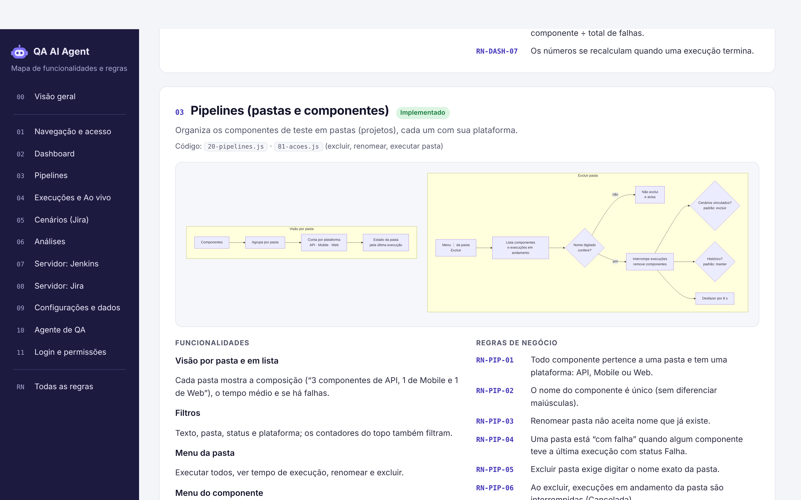
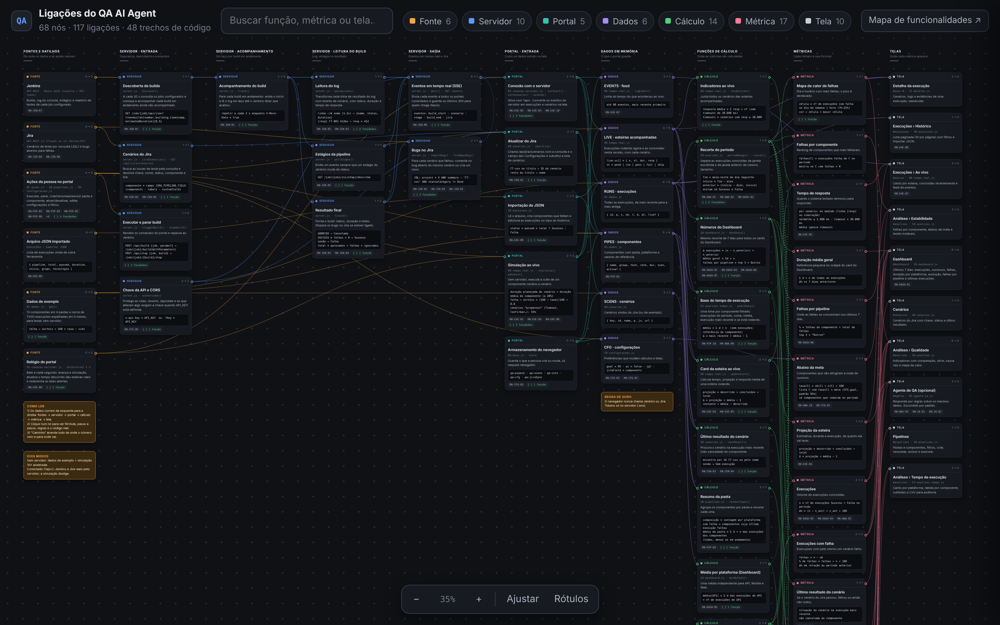
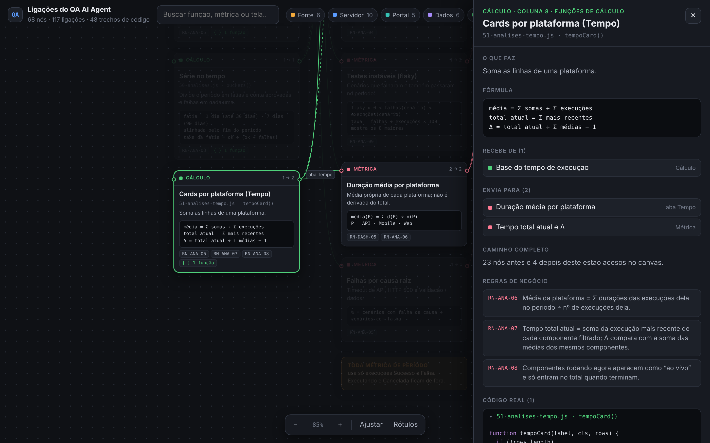
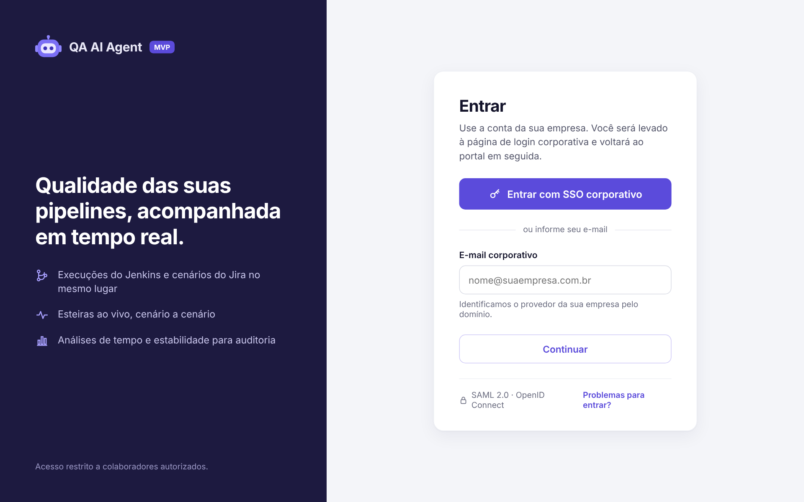
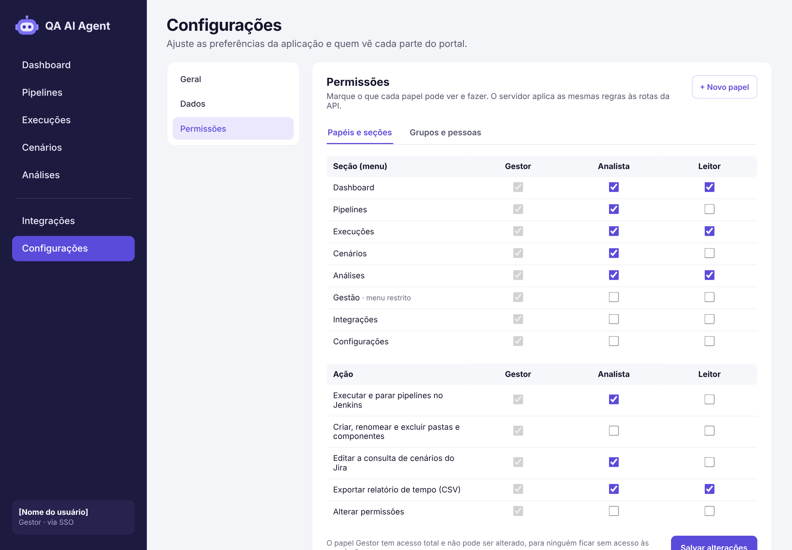
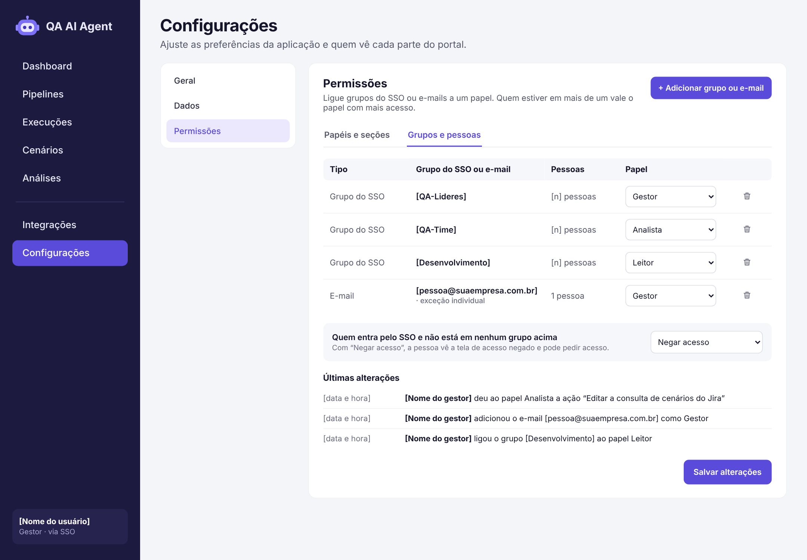
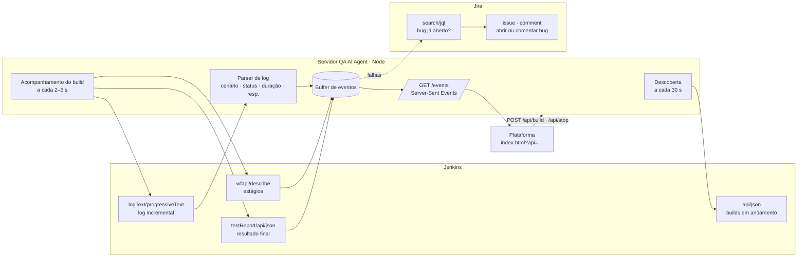
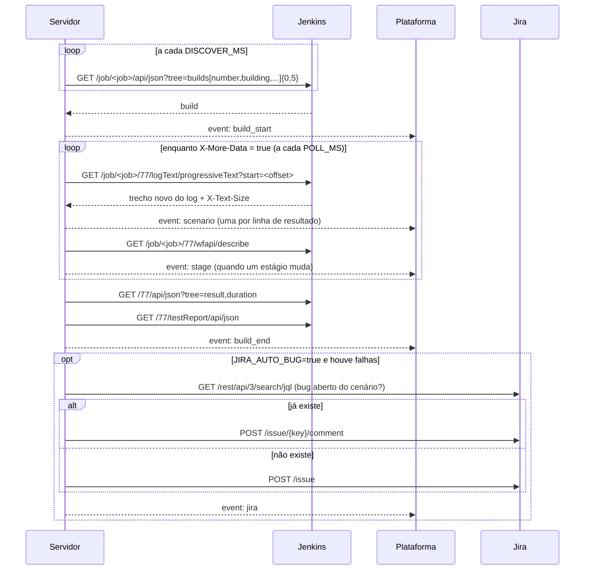

# QA AI Agent


Plataforma para acompanhar a **qualidade das pipelines de teste automatizado**. Ela reúne execuções, cenários, análises de qualidade, acompanhamento **em tempo real** das esteiras e um **agente de IA** que explica falhas e recomenda próximos passos.

O projeto tem duas partes:

| Parte | O que é | Onde |
|---|---|---|
| **Plataforma** | Interface completa (dashboard, pipelines, execuções, tempo real, cenários, análises, agente, integrações e configurações), em um único arquivo HTML sem build | [`index.html`](index.html) |
| **Servidor de tempo real** | Serviço Node.js sem dependências que lê o **Jenkins** e o **GitHub Actions** e integra com o **Jira** usando apenas as **APIs REST**, e transmite os eventos para a plataforma por **Server-Sent Events (SSE)** | [`server/`](server) |


---

## Sumário

- [Funcionalidades](#funcionalidades)
- [Como executar](#como-executar)
- [Estrutura do projeto](#estrutura-do-projeto)
- [Mapa de funcionalidades e Canvas de ligações](#mapa-de-funcionalidades-e-canvas-de-ligações)
- [Login com SSO e permissões (proposta)](#login-com-sso-e-permissões-proposta)
- [Migração e agentes de código](#migração-e-agentes-de-código)
- [Tempo real: arquitetura](#tempo-real-arquitetura)
- [Servidor de tempo real](#servidor-de-tempo-real)
- [Conexão com o GitHub Actions (API REST)](#conexão-com-o-github-actions-api-rest)
- [Conexão com o Jenkins (API REST)](#conexão-com-o-jenkins-api-rest)
- [Conexão com o Jira (API REST)](#conexão-com-o-jira-api-rest)
- [Contrato de eventos (SSE)](#contrato-de-eventos-sse)
- [Rotas do servidor](#rotas-do-servidor)
- [Segurança](#segurança)
- [Dados, persistência e limitações do MVP](#dados-persistência-e-limitações-do-mvp)
- [Personalização](#personalização)
- [Solução de problemas](#solução-de-problemas)
- [Roadmap](#roadmap)

---

## Funcionalidades

Cada informação aparece **em um lugar só**: o resumo fica no Dashboard, os componentes em Pipelines, o acompanhamento em Execuções, os cenários do Jira em Cenários e as métricas em Análises.

| Tela | Para que serve |
|---|---|
| **Dashboard** | Resumo do período e painel do agente de IA |
| **Pipelines** | Pastas (projetos) e componentes; único lugar da contagem por pasta |
| **Execuções** | Abas **Histórico** e **Ao vivo** |
| **Cenários** | Cenários lidos do **Jira pela API**, com o último resultado |
| **Análises** | Abas **Qualidade**, **Tempo de execução** e **Estabilidade**, sem sobreposição |
| **Agente de QA** | Chat com análises e recomendações |
| **Integrações / Configurações** | Conexões e preferências |

### 1. Dashboard (visão geral)
- Mostra sempre os **últimos 7 dias**, calculados a partir das execuções: **execuções** (com a variação em relação aos 7 dias anteriores), **sucessos**, **falhas** e **duração média por plataforma**. O filtro de período fica em **Análises**.
- **Duração média por plataforma:** o card mostra em destaque a média de **API**, **Mobile** e **Web**, cada uma com uma barra comparativa e o número de execuções.
  - **Cada plataforma tem a sua própria média**, que não é derivada do total: soma das durações das execuções concluídas daquela plataforma no período ÷ nº de execuções dela.
  - Passar o mouse mostra a conta (por exemplo `5.628s ÷ 20 execuções`).
  - A média geral do período aparece pequena no rodapé do card, só como referência.
- Gráfico de **evolução da taxa de sucesso**.
- **Falhas por pipeline:** rosca com o total no centro e legenda com quantidade, % e barra por pipeline. Passar o mouse destaca o segmento na rosca.
- **Últimas execuções** e painel do **Agente de QA (IA)**.

### 2. Pipelines (por pasta)
- **Visão por pasta** (padrão). Cada pasta (projeto) mostra:
  - em uma frase, a composição, como *“3 componentes de API, 1 de Mobile e 1 de Web”*;
  - a barra de composição, o tempo médio e o estado (*tudo passando* ou *N com falha*).
- Resumo no topo (*“13 componentes em 4 pastas”*), com contadores por tecnologia que também filtram.
- **Visão em lista**, com filtros por texto, pasta, status e tecnologia.
- **Menu ⋮ da pasta:**
  - **Executar todos os componentes**;
  - **Ver tempo de execução**, que abre Análises já filtrada pelo projeto;
  - **Renomear pasta**;
  - **Excluir pasta**. A confirmação lista os componentes e avisa sobre execuções em andamento, que são interrompidas. Ela oferece duas opções: excluir os cenários vinculados (marcada por padrão) e apagar o histórico (desmarcada por padrão, para preservar a auditoria). É preciso **digitar o nome da pasta** para confirmar, e há **Desfazer** por alguns segundos.
- **Menu ⋮ do componente:** executar agora, ativar ou desativar, ver execuções, analisar com IA e excluir. O botão **+ Nova Pipeline** pede nome, pasta, número de cenários e tecnologia.


### 3. Execuções
- Duas abas no topo: **Histórico** e **Ao vivo**. O contador vermelho mostra quantas esteiras estão rodando.
- **Histórico:** lista paginada, com busca por número ou pipeline, filtros por pipeline, status e período, e **Importar JSON** (veja o [formato](#formato-do-importar-json)).
- **Ao vivo** (atualiza a cada segundo):
  - indicadores: esteiras em execução, cenários concluídos, falhas (quantas por timeout) e tempo médio de resposta;
  - **um card por esteira:**
    - tempo decorrido × média, tempo restante e Δ projetado;
    - barra com um segmento por cenário: verde se passou, vermelho se falhou, roxo se está rodando, cinza se está pendente;
    - lista dos cenários com status, **tempo de resposta (ms)** e duração;
    - ações **Ver detalhes** e **Parar**, que no modo conectado para o build no Jenkins;
  - **concluídas recentemente**, com Analisar com IA e Reexecutar;
  - **eventos**: feed com cada cenário, início e fim de esteira, estágios do Jenkins e bugs do Jira.


### 4. Detalhe da execução
- Cabeçalho com pipeline, pasta, tecnologia, data e duração.
- Indicadores de cenários, sucessos, falhas e taxa de sucesso.
- Abas **Cenários**, **Logs** e **Evidências**.
- Botões **Analisar falhas com IA** e **Reexecutar pipeline**.
- Atualiza ao vivo enquanto a execução está rodando.


### 5. Cenários de teste (lidos do Jira)
- Os cenários **não são cadastrados na plataforma**. Eles vêm do **Jira pela API REST**: o servidor chama o endpoint de busca de issues com uma consulta **JQL**, a linguagem de busca da própria API do Jira.
- A faixa **Origem: Jira** mostra a consulta usada, quantos cenários vieram e a hora da última atualização.
  - **Editar consulta** permite trocar a JQL e o **campo que indica o componente** (`components`, `labels` ou um campo personalizado como `customfield_10045`).
  - **Atualizar do Jira** pede os dados ao servidor (no máximo 1 vez a cada 30 s; o servidor também sincroniza sozinho a cada 5 minutos).
  - **sincronizado há X min** mostra a idade dos dados.
- Colunas:
  - **chave Jira**, com link para a issue;
  - **cenário** (ID `CT-xxx` e nome);
  - **componente**;
  - **status no Jira**;
  - **último resultado**: Sucesso, Falha ou Executando, com link para a execução;
  - **ciclos** (só com o Zephyr Scale ligado): em quais ciclos de teste o cenário aparece e com qual resultado.
- Filtros por texto (chave, ID ou nome), componente, status no Jira, último resultado e **ciclo de teste**. Ao escolher um ciclo, aparece um resumo com a contagem por resultado e os casos que não têm cenário no Jira.
- Sem servidor conectado, a tela mostra cenários de exemplo no mesmo formato.


### 6. Análises
O **filtro de período** (7, 15, 30 ou 90 dias) fica no topo e vale para as três abas. O intervalo de datas aparece logo abaixo do título. Tudo é **recalculado a partir das execuções do período**, e cada indicador é comparado com o período anterior de mesmo tamanho (por exemplo, 30 dias contra os 30 dias antes deles).

**Qualidade:** o que aconteceu no período.
- Indicadores: execuções, taxa de sucesso, execuções com falha e **MTTR** (tempo médio entre uma falha e a próxima execução com sucesso do mesmo componente).
- Sucessos e falhas **por dia**, ou **por semana** no filtro de 90 dias, e a evolução da taxa de sucesso.
- Falhas por causa raiz, agrupadas pela mensagem de erro, e **mapa de calor de falhas por dia da semana e horário**, com o pico destacado.


**Tempo de execução:** uma única visão para acompanhamento e **auditoria**.
- **Filtros:** projeto (pasta), plataforma, **componentes** (um ou vários, agrupados por projeto) e *somente ativos*.
- **Cards Todas, API, Mobile e Web**, cada um com:
  - a **média própria da plataforma** (Σ durações das execuções dela ÷ nº de execuções dela);
  - o **tempo total atual** (soma da execução mais recente de cada componente) com o Δ em relação à soma das médias;
  - quantos estão **rodando agora** e o tempo decorrido.
- **Tabela por componente**, agrupada por projeto:
  - colunas: execução agora (ao vivo), última execução (número e data), tempo mais recente, média com a conta `Σ ÷ n` e Δ;
  - **subtotal por projeto** e **total geral**, comparando a soma dos mais recentes com a soma das médias.
- **Como os tempos são calculados:** um painel expansível com as fórmulas.
- **Copiar relatório (CSV):** copia a tabela filtrada, com período, filtros e a média de cada plataforma, para colar no Excel ou no Google Planilhas.
- Atualiza ao vivo a cada segundo. Os componentes adicionados depois entram sozinhos.


**Estabilidade:** onde e o que falha.
- **Falhas por componente**, só com quem falhou, e a contagem de quem não falhou.
- **Abaixo da meta de sucesso**: os componentes abaixo da meta definida em Configurações.
- **Testes instáveis (flaky):** cenários que falharam e também passaram no período, com falhas / execuções, taxa de falha e o atalho para a análise da IA.

### 7. Agente de QA (chat) — opcional
> **Desligado por padrão.** Enquanto as integrações forem só Jenkins e Jira, os recursos de IA ficam ocultos: o menu Agente de QA, o painel do agente no Dashboard, os botões “Analisar com IA” e a aba IA e Prompts. Para mostrar, ligue **Configurações › Geral › Recursos de IA (Agente de QA)**.

- Chat em tela cheia, que é o mesmo do painel do dashboard, com sugestões de perguntas.
- Responde sobre:
  - falhas por pipeline;
  - uma execução específica (por exemplo *“Por que a execução #10432 falhou?”*);
  - testes instáveis;
  - pipelines mais lentas;
  - resumo da release;
  - o que está rodando agora.
- Mostra os padrões de falha numerados e uma **recomendação**.

> No MVP o agente funciona por **regras sobre os dados carregados**. Ainda não chama um modelo de IA. Veja o [roadmap](#roadmap).


### 8. Integrações
- **Azure DevOps**, **GitLab CI**, **Jenkins**, **GitHub Actions**, **Jira** e **Importação de Arquivo (JSON)**.
- Cada uma tem uma tela de configuração (URL, projeto e token), o status *Conectado* e as opções de sincronizar e desconectar.

> As telas de integração do front-end guardam só o estado da interface. **A conexão real com Jenkins, GitHub Actions e Jira é feita pelo [servidor](#servidor-de-tempo-real)**, que mantém os tokens fora do navegador. No modo conectado (`?api=`), os cartões dessas três integrações aparecem como *Conectado* quando o servidor as tem configuradas. Azure DevOps e GitLab CI ainda são só cartões de interface, sem conexão no servidor.

### 9. Configurações
- **Recursos de IA (Agente de QA):** interruptor em *Geral*, desligado por padrão. Mostra ou oculta tudo o que é de IA.
- **Geral**: nome do workspace, idioma, fuso horário, alertas de falha e resumo semanal.
- **IA e Prompts**: provedor (OpenAI, Anthropic, Azure OpenAI), modelo, **prompt do agente**, temperatura e análise automática de falhas.
- **Dados**: retenção do histórico, meta de taxa de sucesso e restauração dos dados de exemplo.
- **Usuários (MVP)**: lista de usuários e papéis.

---

## Como executar

### Só a plataforma (dados de exemplo + simulação)

Não há build. Abra o arquivo diretamente ou sirva a pasta:

```bash
# opção 1: abrir no navegador
open index.html            # macOS
xdg-open index.html        # Linux

# opção 2: servidor estático local
python3 -m http.server 8080
# acesse http://localhost:8080
```

Sem servidor conectado, a aba **Execuções › Ao vivo** roda uma **simulação 10× acelerada**: três esteiras já em andamento ao abrir e novas execuções iniciadas automaticamente. Ela pode ser desligada em *Simulação automática*.

### Plataforma + servidor de tempo real

```bash
cd server
cp .env.example .env       # preencha Jenkins e/ou GitHub Actions, e o Jira
npm start                  # ou: node --env-file=.env server.js
```

Abra a plataforma apontando para o servidor:

```
http://localhost:8080/index.html?api=http://localhost:3000
http://localhost:8080/index.html?api=https://qa-api.suaempresa.com&key=SUA_API_KEY#aovivo
```

A `key` só é usada na primeira abertura: a tela a guarda na sessão da aba e a **remove da URL** (não fica no histórico nem em favoritos). Veja [Segurança](#segurança).

Com `?api=`:
- a simulação é desligada;
- a aba muda para **“Ao vivo · CI”**;
- a tela **Cenários** passa a ler os cenários do Jira (botão **Atualizar do Jira**);
- os cards passam a refletir os builds reais;
- **Executar** dispara o build no Jenkins ou o workflow no GitHub Actions e **Parar** interrompe a execução.

### Testar sem Jenkins (modo demonstração)

```bash
cd server
npm run demo               # DEMO=true: gera builds e cenários fictícios via SSE
```

Depois abra `index.html?api=http://localhost:3000#aovivo`.

### Publicar a plataforma no GitHub Pages

*Settings → Pages → Deploy from a branch → `main` / root*. A plataforma fica em `https://<usuario>.github.io/qa-ai-agent/`. Configure `CORS_ORIGIN` no servidor com essa origem.

### Testes do servidor

```bash
cd server
npm test
```

O teste sobe um **Jenkins falso** e verifica:
- a descoberta do build;
- a leitura progressiva do log, inclusive com uma linha cortada entre duas leituras;
- o tempo de resposta;
- os estágios;
- o resultado final.

---

## Estrutura do projeto

```
qa-ai-agent/
├── index.html                 marcação das telas e ordem de carga dos scripts
├── assets/
│   ├── css/app.css            estilos (tokens de cor e fonte no :root)
│   └── js/                    um módulo por tela, carregados em ordem
│       ├── 00-base.js           utilitários, ícones e menu
│       ├── 01-dados.js          dados de exemplo (PIPES, RUNS, SCENS)
│       ├── 10-dashboard.js      Dashboard
│       ├── 20-pipelines.js      Pipelines
│       ├── 30-execucoes.js      Execuções › Histórico
│       ├── 31-detalhe.js        Detalhe da execução
│       ├── 40-cenarios.js       Cenários (Jira)
│       ├── 50-analises.js       Análises › Qualidade e Estabilidade
│       ├── 51-analises-tempo.js Análises › Tempo de execução
│       ├── 60-integracoes.js    Integrações
│       ├── 70-configuracoes.js  Configurações
│       ├── 80-navegacao.js      rotas
│       ├── 81-acoes.js          modais, menus e ações globais
│       ├── 90-tempo-real.js     Execuções › Ao vivo
│       ├── 91-conexao-servidor.js modo conectado (SSE)
│       ├── 95-agente-ia.js      Agente de QA (opcional)
│       └── 99-inicio.js         inicialização
├── server/
│   ├── server.js              Jenkins + GitHub Actions + Jira via API REST, SSE e rotas /api
│   ├── package.json           scripts start / demo / test (sem dependências)
│   ├── .env.example           todas as variáveis de configuração
│   └── test/                  testes com Jenkins, GitHub e Jira falsos
├── docs/
│   ├── CONTRATOS.md           formatos de dados, eventos e rotas
│   ├── MAPA.md                guia do Mapa de funcionalidades e do Canvas de ligações
│   ├── mapa/                  gerar_docs.py · PROMPT.md · mapa-funcionalidades.html · canvas-ligacoes.html
│   ├── SSO.md                 proposta de login com SSO e permissões
│   ├── prototipos/sso/        protótipos HTML das telas de login e permissões
│   ├── MIGRACAO.md            guia para trazer o projeto antigo
│   ├── migracao/inventario.md tabela origem → destino (preenchida na migração)
│   └── img/                   capturas do README (img/sso: esboços do login; mapa e canvas)
├── mapa.config.json           conteúdo do Mapa e do Canvas (regras, fórmulas, diagramas, nós)
├── AGENTS.md                  regras para agentes de código (Antigravity e outros)
├── .agents/rules/migracao.md  regras de migração carregadas pelo Antigravity
├── .prettierrc.json · .editorconfig · .gitattributes   formatação e finais de linha padronizados
└── README.md
```

Não há build. Os módulos são scripts clássicos que **compartilham o escopo global**, por isso a ordem no `index.html` importa: um arquivo só pode executar na carga o que foi definido em arquivos de número menor.

## Mapa de funcionalidades e Canvas de ligações

Dois documentos mostram **como a plataforma funciona por dentro**. Abra direto no navegador; o guia completo está em [`docs/MAPA.md`](docs/MAPA.md).

| Documento | Responde | Abrir |
|---|---|---|
| **Mapa de funcionalidades** | *Qual é a regra?* Funcionalidades separadas por categoria, um diagrama da lógica de cada uma e **118 regras de negócio numeradas** (RN-DASH-01, RN-ANA-06…), com catálogo e filtro. | [`docs/mapa/mapa-funcionalidades.html`](docs/mapa/mapa-funcionalidades.html) |
| **Canvas de ligações** | *De onde vem esse número?* Canvas de nós ligando fontes → servidor → dados → funções de cálculo → métricas → telas, com **fórmula, regras e código real** de cada função. | [`docs/mapa/canvas-ligacoes.html`](docs/mapa/canvas-ligacoes.html) |

| Mapa de funcionalidades | Canvas de ligações |
|---|---|
|  |  |

No Canvas, clicar num nó abre o painel com a fórmula, o passo a passo, as entradas e saídas, as regras e o código. Ao mesmo tempo, **acende o caminho completo** daquele número:



Principais fórmulas, como aparecem nos dois documentos:

| Métrica | Fórmula |
|---|---|
| Taxa de sucesso | `ok ÷ n × 100`, contando só execuções Sucesso e Falha do período |
| Comparação | mesmo período imediatamente anterior, de mesmo tamanho |
| MTTR | média de (próximo Sucesso − 1ª Falha), por componente |
| Média por plataforma | `Σ duração ÷ nº de execuções` **da própria plataforma**, nunca derivada do total |
| Tempo total atual | soma da execução mais recente de cada componente; Δ = total ÷ Σ médias − 1 |
| Projeção ao vivo | `decorrido ÷ cenários concluídos × total de cenários` |
| Flaky | cenário que falhou **e** passou no período |
| Abaixo da meta | componentes com taxa < `CFG.goal` (95% por padrão) |

Os dois são **gerados a partir do código** com um comando, sem instalar nada (Python 3.8+):

```bash
python3 docs/mapa/gerar_docs.py
```

O script lê o projeto inteiro (funções, quem chama quem, rotas, eventos, variáveis de ambiente, chaves do navegador) e junta o que só uma pessoa sabe, que fica em [`mapa.config.json`](mapa.config.json): categorias, regras, fórmulas e diagramas. Ele **para com erro** se algo citado deixou de existir (função renomeada, regra inexistente), então a documentação não desatualiza sem ninguém perceber. Para **usar em outro projeto**, copie só o `gerar_docs.py`; o passo a passo e o prompt para uma IA preencher o config estão em [`docs/MAPA.md`](docs/MAPA.md).

## Login com SSO e permissões (proposta)

> **Esboço, ainda não implementado.** Os detalhes, o fluxo e as decisões em aberto estão em [`docs/SSO.md`](docs/SSO.md). Os protótipos navegáveis ficam em [`docs/prototipos/sso/`](docs/prototipos/sso).

- **Login pelo SSO da empresa** (OpenID Connect ou SAML 2.0), com telas de redirecionamento e de acesso negado.
- **Permissões por papel** (Gestor, Analista, Leitor): cada papel define as **seções do menu** que vê e as **ações** que pode fazer. Os papéis são ligados a **grupos do SSO** ou a **e-mails**.
- **O servidor aplica as mesmas regras às rotas da API.** Esconder menus na tela não basta.

| Login | Permissões |
|---|---|
|  |  |
|  |  |

## Migração e agentes de código

O projeto está preparado para um agente (Antigravity, Claude Code, Copilot…) trazer as informações do projeto antigo sem gerar conflitos:

- **[`AGENTS.md`](AGENTS.md)** e **[`.agents/rules/`](.agents/rules)** são carregados sozinhos pelo Antigravity. Eles contêm as regras do projeto: onde cada coisa fica, credenciais só no servidor, contratos estáveis, IA desligada e português.
- **[`docs/CONTRATOS.md`](docs/CONTRATOS.md)** define os formatos de componente, execução, cenário, eventos SSE e rotas. Dados antigos são **convertidos para esses formatos** no servidor.
- **[`docs/MIGRACAO.md`](docs/MIGRACAO.md)** traz o passo a passo e um **texto pronto para colar no agente**. Primeiro ele faz o inventário (origem → destino, sem mexer no código), depois migra um item por commit.
- **Código em módulos pequenos** e formatação padronizada (`.prettierrc.json`, `.editorconfig`, `.gitattributes` com LF) reduzem conflitos de merge.

## Tempo real: arquitetura

A conexão com o Jenkins, o GitHub Actions e o Jira é feita **toda por API REST (polling)**. Você não precisa de plugin de webhook, nem de mudança no Jenkinsfile, nem de reporter especial nos testes.



### Fluxo de um build



**Por que SSE e não WebSocket?** O fluxo é de mão única (servidor → tela), e o SSE:
- funciona sobre HTTP comum, inclusive atrás de proxies;
- reconecta sozinho (`retry: 3000`);
- não precisa de biblioteca nenhuma, nem no servidor nem no navegador (`EventSource`).

Os comandos da tela, como executar e parar, vão por `POST` normal.

**Latência esperada:** o intervalo de polling (`POLL_MS`, padrão 3 s) mais o tempo do teste imprimir a linha no console. Para uma tela de acompanhamento, 2–5 s é o equilíbrio entre atraso e carga no Jenkins.

### Proteção contra limite de requisições

Como a leitura é por polling, o servidor se protege para não esgotar o limite do Jenkins, do Jira ou do Zephyr:

- **Espera e nova tentativa:** respostas `429`, `502`, `503` e `504` e quedas de rede são repetidas até 3 vezes (`HTTP_RETRIES`), com espera crescente. Se o servidor mandar `Retry-After`, ele vale. Chamadas que criam algo (`POST`) só repetem quando o servidor recusou por limite, para não duplicar.
- **GitHub:** o limite do GitHub vem como `403` (ou `429`) com `x-ratelimit-remaining: 0` ou `Retry-After`; o servidor reconhece, espera até o `x-ratelimit-reset` (no máximo 5 min por vez) e **não faz nenhuma chamada enquanto o limite estiver esgotado**. Um `403` comum, de permissão, continua sendo erro. Respostas `304` (ETag) não gastam limite, e o intervalo de leitura quadruplica quando restam menos de 200 chamadas.
- **Erro passageiro não vira Falha:** se a leitura do log falhar por limite ou queda, o build **não** é marcado como Falha; o servidor adia a leitura e tenta de novo (até `TRACK_MAX_ERRORS`).
- **Menos chamadas:** os estágios são lidos a cada 3 leituras do log (`STAGES_EVERY`).
- **Intervalo adaptativo:** cada `429` dobra o intervalo de leitura (até 8 vezes) e ele volta ao normal aos poucos. Acima de 5 builds simultâneos o intervalo também aumenta, e no máximo 10 são acompanhados (`MAX_TRACKED_BUILDS`).
- **Cache do Jira:** a tela lê um cache do servidor, então o número de pessoas com o portal aberto **não** aumenta as chamadas ao Jira.

O fator de lentidão aparece em `GET /api/health` (`slow`; `1` = normal).

---

## Servidor de tempo real

- **Requisitos:** Node.js **20.6+** (usa `fetch` nativo e `--env-file`). Não há `npm install`.
- **Configuração:** todas as variáveis estão em [`server/.env.example`](server/.env.example).

| Variável | Padrão | Descrição |
|---|---|---|
| `PORT` | `3000` | Porta HTTP |
| `CORS_ORIGIN` | `*` | Origem permitida da plataforma (por exemplo `https://usuario.github.io`) |
| `API_KEY` / `API_KEY_HASH` | vazio | Se definida, é exigida no header `x-api-key` (e em `/events` por tíquete). `API_KEY_HASH` guarda só o hash scrypt. Aceitam o formato cifrado; veja [Segurança](#segurança) |
| `SECRETS_KEY_FILE` | — | Arquivo com a chave-mestra para decifrar valores `enc:v1:…` |
| `TLS_CERT_FILE` / `TLS_KEY_FILE` | — | HTTPS nativo (opcional) |
| `TRUST_PROXY`, `AUTH_MAX_FAILS`, `AUTH_FAIL_WINDOW_MS`, `TICKET_TTL_MS`, `MAX_SSE_CLIENTS` | `false`, `10`, `300000`, `30000`, `200` | Bloqueio de tentativas, tíquete do SSE e limite de conexões |
| `ALLOW_URL_KEY`, `ALLOW_INSECURE_UPSTREAM` | `false` | Compatibilidade: aceitar `?key=` na URL e upstream `http://` com credencial |
| `DEMO` | `false` | `true` gera execuções fictícias, sem Jenkins |
| `JENKINS_URL` | — | Endereço do Jenkins |
| `JENKINS_USER` / `JENKINS_TOKEN` | — | Usuário e **API token** (Basic Auth) |
| `JENKINS_JOBS` | — | Jobs acompanhados, separados por vírgula. Jobs em pastas: `Pasta/Sub/Job` |
| `POLL_MS` | `3000` | Intervalo de leitura do log de um build em andamento |
| `DISCOVER_MS` | `30000` | Intervalo para descobrir builds novos |
| `LOG_REGEX` | embutida | Regex própria para as linhas de resultado (grupos `status`, `name`, `dur`, `unit`) |
| `RESP_REGEX` | `\[resp\]\s+(?<name>.+?)\s+(?<ms>\d+)\s*ms` | Regex do tempo de resposta (grupos `name`, `ms`) |
| `GITHUB_TOKEN` | — | Token com permissão de leitura em Actions e Metadata |
| `GITHUB_WORKFLOWS` | — | `dono/repo/arquivo.yml` (um workflow) ou `dono/repo` (todos do repositório), separados por vírgula |
| `GITHUB_API_URL` | `https://api.github.com` | GitHub Enterprise Server: `https://github.suaempresa.com/api/v3` |
| `GITHUB_POLL_MS` / `GITHUB_DISCOVER_MS` | `10000` / `30000` | Leitura de um run em andamento · busca de runs novos |
| `GITHUB_LOG_JOBS` | todos | Expressão: só baixa o log dos jobs cujo nome casa (cada log custa 1 chamada) |
| `JIRA_URL` | — | Por exemplo `https://suaempresa.atlassian.net` |
| `JIRA_EMAIL` / `JIRA_TOKEN` | — | E-mail e API token (Cloud) ou usuário e token pessoal (Server/DC) |
| `JIRA_PROJECT` | — | Chave do projeto (por exemplo `QA`) |
| `JIRA_API_VERSION` | `3` | `3` = Cloud · `2` = Server/Data Center |
| `JIRA_AUTO_BUG` | `false` | Abre ou comenta um bug para cada cenário que falhar |
| `JIRA_ISSUE_TYPE` | `Bug` | Tipo de issue criado |
| `JIRA_LABELS` | `qa-ai-agent` | Labels aplicadas, separadas por vírgula |
| `JIRA_SCENARIOS_JQL` | `project = QA AND issuetype = Test ORDER BY key` | Consulta (JQL) usada na API do Jira para buscar os cenários |
| `JIRA_PIPELINE_FIELD` | `components` | Campo do Jira que indica o componente do cenário (`components`, `labels` ou `customfield_xxxxx`) |
| `JIRA_AUTH` | `basic` | `basic` = e-mail/usuário + token · `bearer` = token pessoal (PAT) do Data Center |
| `JIRA_SYNC_MS` | `300000` | Intervalo da sincronização do Jira (5 min). `0` desliga |
| `JIRA_FULL_SYNC_MS` | `21600000` | Rodada completa a cada 6 h; as outras trazem só o que mudou |
| `JIRA_AFTER_BUILD_MS` | `20000` | Depois de cada build, relê os ciclos ativos após este tempo. `0` desliga |
| `JIRA_GAP_MS` / `JIRA_MIN_MANUAL_MS` | `200` / `30000` | Pausa entre chamadas seguidas · intervalo mínimo entre atualizações manuais |
| `ZEPHYR` | `false` | `true` lê os ciclos de teste do Zephyr Scale (Server/Data Center) |
| `ZEPHYR_API_PATH` | `/rest/atm/1.0` | Prefixo da API ATM do Zephyr, no endereço do Jira |
| `ZEPHYR_TQL` | `projectKey = "<JIRA_PROJECT>"` | Escolhe quais ciclos acompanhar |
| `ZEPHYR_CASE_FIELD` | vazio | Campo da issue do cenário com a chave do caso (`PROJ-T123`). Vazio = título e labels |
| `ZEPHYR_MAX_CYCLES` / `ZEPHYR_ACTIVE_DAYS` / `ZEPHYR_CLOSED_STATUS` | `100` / `30` / `Done` | Quantos ciclos · por quantos dias um ciclo é "ativo" · status que encerram o ciclo |
| `HTTP_RETRIES` / `HTTP_BACKOFF_MS` / `HTTP_MAX_WAIT_MS` | `3` / `1000` / `60000` | Repetições, espera inicial e espera máxima em 429/503 |
| `STAGES_EVERY` / `TRACK_MAX_ERRORS` / `MAX_TRACKED_BUILDS` | `3` / `5` / `10` | Estágios a cada N leituras · erros seguidos antes de dar Falha · builds acompanhados ao mesmo tempo |

---

## Conexão com o GitHub Actions (API REST)

O GitHub Actions entra pelo mesmo caminho do Jenkins e aparece na mesma tela **Execuções › Ao vivo**. Os dois podem rodar juntos no mesmo servidor.

### Autenticação
1. No GitHub: **Settings › Developer settings › Personal access tokens › Fine-grained tokens**, com acesso aos repositórios acompanhados.
2. Permissões: **Actions: Read** e **Metadata: Read**. Para os botões Executar e Parar, **Actions: Read and write**.
3. Informe `GITHUB_TOKEN` e `GITHUB_WORKFLOWS` (por exemplo `suaempresa/loja/e2e.yml`). O servidor envia `Authorization: Bearer <token>`. No GitHub Enterprise Server, ajuste `GITHUB_API_URL`.

### Como cada conceito do Jenkins aparece

| Jenkins | GitHub Actions |
|---|---|
| pasta | repositório |
| job | workflow (`dono/repo/arquivo.yml`) |
| build | run (`run_number`) |
| estágio | job do workflow |
| linha de resultado no log | linha de resultado no log do job (mesmos formatos e `LOG_REGEX`) |

### Endpoints usados

| Para quê | Endpoint |
|---|---|
| Descobrir runs em andamento | `GET /repos/{dono}/{repo}/actions/workflows/{arquivo}/runs?per_page=5` (ou `/actions/runs` para o repositório todo) |
| Andamento do run | `GET /repos/{dono}/{repo}/actions/runs/{id}` |
| Jobs (estágios) | `GET /repos/{dono}/{repo}/actions/runs/{id}/jobs` |
| **Cenários** | `GET /repos/{dono}/{repo}/actions/jobs/{id}/logs`, lido uma vez quando o job termina |
| Disparar | `POST /repos/{dono}/{repo}/actions/workflows/{arquivo}/dispatches` (o workflow precisa de `on: workflow_dispatch`) |
| Parar | `POST /repos/{dono}/{repo}/actions/runs/{id}/cancel` |

### O que é diferente do Jenkins
- **Os cenários chegam por job, não linha a linha.** A API do GitHub só libera o log de um job depois que ele termina. Durante a execução a tela mostra o andamento pelos jobs (estágios); quando um job acaba, todos os seus cenários aparecem de uma vez.
- **Custo:** a cada 10 s, 2 chamadas por run em andamento (run e jobs) mais 1 por job concluído (log). As respostas `304` por ETag não contam no limite de 5.000 chamadas por hora do token.
- Um *re-run* mantém o mesmo número de execução e não aparece como execução nova.
- O formato do log depende do seu framework de testes: confira se as linhas de resultado batem com o padrão embutido ou ajuste `LOG_REGEX`.

---

## Conexão com o Jenkins (API REST)

### Autenticação
1. No Jenkins: **seu usuário → Security → API Token → Add new Token**.
2. Use `JENKINS_USER` e `JENKINS_TOKEN`. O servidor envia `Authorization: Basic base64(usuario:token)`.

Com API token, o Jenkins **não exige crumb (CSRF)** para `POST` (build e stop). Dê ao usuário, no mínimo, as permissões **Overall/Read**, **Job/Read** e, se for usar Executar e Parar, **Job/Build** e **Job/Cancel**.

### Endpoints usados

| Para quê | Endpoint |
|---|---|
| Descobrir builds em andamento | `GET /job/<job>/api/json?tree=builds[number,building,timestamp,estimatedDuration]{0,5}` |
| **Log incremental (tempo real por cenário)** | `GET /job/<job>/<n>/logText/progressiveText?start=<offset>` |
| Estágios da pipeline | `GET /job/<job>/<n>/wfapi/describe` (plugin *Pipeline: Stage View*; se não existir, é ignorado) |
| Resultado e duração | `GET /job/<job>/<n>/api/json?tree=result,duration` |
| Totais do relatório de testes | `GET /job/<job>/<n>/testReport/api/json?tree=passCount,failCount,skipCount` (exige `junit` publicado) |
| Disparar build | `POST /job/<job>/build` ou `/buildWithParameters` |
| Parar build | `POST /job/<job>/<n>/stop` |

Jobs dentro de pastas viram `/job/Pasta/job/Sub/job/Job`. O servidor monta esse caminho sozinho a partir de `Pasta/Sub/Job`.

### Como o tempo real por cenário funciona
O `progressiveText` devolve **só o trecho novo do log** a partir de `start`. Ele também traz dois cabeçalhos:
- `X-Text-Size`: onde continuar na próxima leitura;
- `X-More-Data: true`: enquanto o build não terminou.

O servidor:
- guarda o resto de linha que veio cortado entre uma leitura e outra;
- remove as cores ANSI;
- reconhece as linhas de resultado.

Formatos reconhecidos **por padrão**:

```text
# Playwright (reporter "list")
  ✓  1 [chromium] › checkout.spec.ts:12:5 › CT-001 Fluxo de compra completo (1.2s)
  ✘  3 [chromium] › checkout.spec.ts:30:5 › CT-004 Timeout na API de pagamento (30.0s)
# Cypress / Mocha (reporter "spec")
  ✓ CT-002 Aplicar cupom de desconto (842ms)
# Jest
  ✕ CT-010 Validar CPF duplicado (12 ms)
```

Para outro formato (Robot Framework, Karate, pytest, Cucumber…), defina `LOG_REGEX` com grupos nomeados:

```bash
# pytest -v:  tests/test_checkout.py::test_ct_001_fluxo_compra PASSED  [ 10%]
LOG_REGEX=^(?<name>\S+::\S+)\s+(?<status>PASSED|FAILED)
# Robot Framework:  CT-001 Fluxo de compra completo                | PASS |
LOG_REGEX=^(?<name>CT-\d+.+?)\s+\|\s+(?<status>PASS|FAIL)\s+\|
```

Os status de sucesso aceitos são `✓ ✔ √ ok OK pass passed PASS PASSED Passed SUCCESS`, e qualquer outro conta como falha. Se a sua ferramenta usa outra palavra, acrescente-a ao conjunto `PASS` em `server.js`. A duração é opcional.

### Tempo de resposta (ms) de cada cenário
O tempo de resposta não aparece no log por padrão. Basta o teste imprimir uma linha antes de terminar:

```js
// Playwright
const inicio = Date.now();
const resp = await request.post('/api/payments/authorize', { data });
console.log(`[resp] CT-004 Timeout na API de pagamento ${Date.now() - inicio}ms`);
```

O servidor associa a linha `[resp]` ao cenário pelo nome ou pelo ID `CT-xxx`, e envia o valor no evento `scenario`. O formato pode ser trocado em `RESP_REGEX`.

### Boas práticas
- Comece cada nome de cenário com o ID (`CT-001 …`). Isso liga o log, a plataforma e o Jira.
- Publique o JUnit (`junit 'results/*.xml'`) para o total final vir do `testReport`.
- Mantenha `POLL_MS` entre 2000 e 5000 e `DISCOVER_MS` entre 15000 e 60000.

---

## Conexão com o Jira (API REST)

### Autenticação

| Jira | Credenciais | `JIRA_API_VERSION` |
|---|---|---|
| **Cloud** | E-mail + API token (gere em `id.atlassian.com → Security → API tokens`) | `3` |
| **Server / Data Center** | Usuário + Personal Access Token | `2` |

### Cenários de teste (leitura pela API)
A tela **Cenários** chama `GET /api/jira/scenarios`. O servidor então consulta a API de busca do Jira com a JQL configurada, paginando até 1000 issues:
- **Cloud (v3):** `GET /rest/api/3/search/jql?jql=…&fields=summary,status,components,labels,updated&nextPageToken=…`
- **Server/DC (v2):** `GET /rest/api/2/search?jql=…&startAt=…`

O resultado vem assim:

```json
{ "scenarios": [ { "key": "QA-101", "name": "CT-001 Fluxo de compra completo", "status": "Pronto",
                   "pipeline": "Checkout", "url": "https://suaempresa.atlassian.net/browse/QA-101" } ] }
```

- **Consulta padrão:** `JIRA_SCENARIOS_JQL`. A plataforma pode mandar outra com *Editar consulta*.
- **Componente/pipeline:** vem do campo `JIRA_PIPELINE_FIELD`: `components` (padrão), `labels` ou `customfield_xxxxx`.
- **ID do cenário:** se o título da issue começa com `CT-xxx`, esse ID liga o cenário às linhas do log do Jenkins e ao último resultado.

### Sincronização e ciclos de teste (Zephyr Scale)

O servidor consulta o Jira **sozinho**, a cada 5 minutos, e guarda o resultado em cache. A tela só lê esse cache (`GET /api/jira/state`) e é avisada pelo evento `jira_sync`. Assim o Jira recebe as mesmas poucas chamadas, não importa quantas pessoas abrem o portal.

- **Incremental:** a primeira rodada e uma a cada 6 horas são completas. As demais trazem só as issues alteradas, com `(consulta) AND updated >= -Nm`. O tempo relativo evita erro de fuso horário.
- **Ciclos:** com `ZEPHYR=true`, o servidor lê os ciclos (`testrun`) e o resultado de cada caso pela **API ATM do Zephyr Scale Server/Data Center**, no endereço do próprio Jira e com a mesma autenticação. Só os ciclos **ativos** (não encerrados e atualizados nos últimos 30 dias) são relidos a cada rodada; os encerrados são lidos uma vez.
- **Depois de cada build**, os ciclos ativos são relidos 20 s depois, para dar tempo do Zephyr receber os resultados.
- **Ligação com o cenário:** o caso do ciclo vira o cenário pela **chave do caso** (`PROJ-T123`), guardada na issue do cenário. Configure o campo em `ZEPHYR_CASE_FIELD` (por exemplo `customfield_10200`); se ficar vazio, o servidor procura a chave no título e nos labels.
- **Falha do Jira:** o servidor mantém os últimos dados e a tela avisa "última tentativa falhou".

```env
ZEPHYR=true
ZEPHYR_CASE_FIELD=customfield_10200
JIRA_AUTH=bearer          # Data Center com token pessoal
```

> **Confirme a API do Zephyr no seu ambiente.** Os caminhos (`/testrun/search`, `/testrun/{chave}`) e o formato das respostas seguem a API ATM do Server/Data Center, mas foram escritos sem acesso a um Jira real; os testes usam um Jira falso. Se o formato for diferente, o ajuste fica em `zephyrList()` e `zephyrItems()`, em `server/server.js`. Detalhes em [`docs/CONTRATOS.md`](docs/CONTRATOS.md).

### O que o servidor faz com as falhas
Com `JIRA_AUTO_BUG=true`, ao fim de cada build, para cada cenário que falhou:

1. **Procura um bug aberto** do mesmo cenário:
   - Cloud: `GET /rest/api/3/search/jql?jql=project="QA" AND summary ~ "\"CT-004\"" AND statusCategory != Done`
   - Server: `GET /rest/api/2/search?jql=…`
2. **Se existe:** adiciona um comentário com `POST /rest/api/{v}/issue/{chave}/comment`, sem criar duplicado.
3. **Se não existe:** cria o bug com `POST /rest/api/{v}/issue`:
   - título `[QA] <job> – <cenário>`;
   - descrição com o cenário, o build e o link do build;
   - labels de `JIRA_LABELS`.
4. Envia o evento `jira` para a plataforma, que aparece no feed **Eventos**.

No Jira Cloud (v3), a descrição e o comentário vão em **Atlassian Document Format (ADF)**. O servidor converte o texto sozinho.

Para abrir um bug manualmente, por exemplo a partir de um botão:

```bash
curl -X POST http://localhost:3000/api/jira/bug \
  -H 'Content-Type: application/json' -H 'x-api-key: SUA_API_KEY' \
  -d '{"job":"E-commerce/Checkout","build":77,"scenario":"CT-004 Timeout na API de pagamento"}'
```

Permissões necessárias no projeto: **Browse Projects**, **Create Issues** e **Add Comments**.

---

## Contrato de eventos (SSE)

`GET /events` mantém a conexão aberta e envia eventos no formato:

```
event: <tipo>
data: <json>
```

Ao conectar, o cliente recebe os **últimos 300 eventos**, para montar o estado atual. Qualquer outra fonte (GitLab, Azure DevOps, um reporter próprio) pode alimentar a plataforma, desde que publique estes eventos.

| Evento | Quando | Campos |
|---|---|---|
| `build_start` | Build descoberto em andamento | `job`, `build`, `timestamp`, `estimatedDuration?`, `folder?`, `url`, `total?`, `scenarios?`, `name?`, `source?` (`Jenkins`/`GitHub Actions`), `branch?` |
| `scenario` | Uma linha de resultado no log | `job`, `build`, `name`, `status` (`pass`/`fail`/`run`), `duration` (s), `resp` (ms ou `null`), `elapsed` (s) |
| `stage` | Estágio do Jenkins (ou job do GitHub Actions) mudou de status | `job`, `build`, `stage`, `status`, `duration` (ms) |
| `build_end` | Build terminou | `job`, `build`, `status` (`Sucesso`/`Falha`/`Cancelada`), `duration` (ms), `passed`, `failed`, `total`, `result` |
| `jira` | Bug criado ou comentado | `job`, `build`, `scenario`, `key`, `action` (`create`/`comment`), `url` |

Exemplo:

```json
{"job":"E-commerce/Checkout","build":77,"name":"CT-004 Timeout na API de pagamento","status":"fail","duration":30,"resp":30000,"elapsed":64}
```

Consumo no navegador, como a plataforma faz:

```js
// o EventSource não envia cabeçalhos: peça um tíquete de uso único e conecte com ele
const { ticket } = await (await fetch('http://localhost:3000/api/ticket', { method: 'POST', headers: { 'x-api-key': 'SUA_API_KEY' } })).json();
const es = new EventSource('http://localhost:3000/events?ticket=' + ticket);
es.addEventListener('scenario', e => console.log(JSON.parse(e.data)));
```

---

## Rotas do servidor

| Método | Rota | Autenticação | Descrição |
|---|---|---|---|
| `GET` | `/api/health` | livre | Estado do servidor: modo demo, Jenkins/GitHub/Jira/Zephyr configurados, limite restante do GitHub (`githubRate`), última sincronização do Jira, fator de lentidão (`slow`), clientes conectados, builds ativos |
| `POST` | `/api/ticket` | `x-api-key` | Gera um tíquete de uso único (30 s) para abrir o SSE |
| `GET` | `/events` | `?ticket=` ou `x-api-key` | Fluxo SSE de eventos |
| `GET` | `/api/state` | `x-api-key` | Builds em acompanhamento, com cenários e estágios |
| `POST` | `/api/build` | `x-api-key` | `{ "job": "E-commerce/Checkout", "params": { "AMBIENTE": "hml" } }` dispara o build |
| `POST` | `/api/stop` | `x-api-key` | `{ "job": "...", "build": 77 }` para o build |
| `GET` | `/api/jira/scenarios` | `x-api-key` | `?jql=...&field=components` busca os cenários de teste no Jira |
| `GET` | `/api/jira/state` | `x-api-key` | Cenários e ciclos em cache (não chama o Jira) |
| `POST` | `/api/jira/sync` | `x-api-key` | Atualização manual; no máximo 1 a cada 30 s, antes disso devolve o cache com `throttled: true` |
| `POST` | `/api/jira/bug` | `x-api-key` | `{ "job", "build", "scenario", "details?" }` abre ou comenta o bug |

---

## Segurança

Resumo: **nenhuma senha ou token fica em texto puro no disco, no navegador ou no log.** Tudo é opcional e retrocompatível, mas recomendado.

### Segredos cifrados (AES-256-GCM)

Os valores de `JENKINS_TOKEN`, `GITHUB_TOKEN`, `JIRA_TOKEN` e `API_KEY` aceitam o formato `enc:v1:…`. O servidor decifra **só na memória**, ao iniciar. Cada valor tem salt e IV próprios, a chave é derivada com scrypt (N=2¹⁵) e o GCM detecta qualquer alteração.

```bash
cd server
npm run segredos -- gerar-chave ~/.qa-ai-agent.key        # chave-mestra (arquivo 600, fora do repositório)
export SECRETS_KEY_FILE=~/.qa-ai-agent.key
printf %s "$MEU_TOKEN" | npm run --silent segredos -- cifrar   # cole o resultado no .env: JENKINS_TOKEN=enc:v1:...
printf %s "minha-chave-da-api" | npm run --silent segredos -- hash-chave   # API_KEY_HASH=scrypt:v1:...
npm run segredos -- verificar .env                        # confere se tudo abre e aponta o que está em claro
```

- O segredo entra pelo **stdin**, nunca como argumento (não vai para o histórico do shell).
- A chave-mestra vem de `SECRETS_KEY_FILE` (preferido) ou `SECRETS_KEY`, e é **apagada do ambiente** depois de lida.
- **Guarde um backup da chave-mestra** em um cofre (Vault, Secrets Manager, gerenciador de senhas). Sem ela os valores cifrados não abrem.
- Chave errada ou valor adulterado: o servidor **não sobe** e diz qual variável falhou.
- A cifra protege o `.env` em repouso (backup, disco, repositório por engano). Quem controla o processo e a chave-mestra ainda lê os segredos; por isso a chave-mestra deve ficar em outro lugar (arquivo 600, secret do orquestrador).
- Se um token já esteve em texto puro em algum lugar, **revogue e gere outro**; cifrar depois não desfaz o vazamento.

### Chave da API e conexão em tempo real

- **`API_KEY_HASH`** guarda só o hash scrypt da chave: o servidor nunca tem a chave em si. Use `API_KEY` **ou** `API_KEY_HASH`.
- A chave vai no cabeçalho **`x-api-key`**. O `?key=` na URL fica **desligado** (vazaria em histórico, logs e Referer); `ALLOW_URL_KEY=true` só para compatibilidade.
- O SSE usa **tíquete de uso único**: a plataforma chama `POST /api/ticket` com a chave e conecta em `/events?ticket=…` (vale 30 s e uma conexão). A tela guarda a chave só na `sessionStorage` da aba e a remove da URL assim que abre. Se a conexão cair, pede outro tíquete e reconecta sozinha.
- **Bloqueio de tentativas:** depois de 10 falhas em 5 min, o IP recebe `429` (`AUTH_MAX_FAILS`, `AUTH_FAIL_WINDOW_MS`). Atrás de proxy, use `TRUST_PROXY=true` para considerar o `X-Forwarded-For`.
- Comparações de chave em tempo constante; `/api/health` sem chave não mostra jobs, workflows nem limite do token.

### Transporte

- **TLS no servidor:** `TLS_CERT_FILE` + `TLS_KEY_FILE` ligam HTTPS nativo (TLS 1.2+, HSTS). Ou publique atrás de Nginx, Caddy ou o load balancer com HTTPS.
- **Upstreams só por HTTPS:** com token configurado, `JENKINS_URL`, `JIRA_URL` e `GITHUB_API_URL` precisam ser `https://` (exceto `localhost`), ou o servidor não inicia. Em rede interna confiável, `ALLOW_INSECURE_UPSTREAM=true`.
- Respostas com `X-Content-Type-Options`, `Cache-Control: no-store`, `Referrer-Policy: no-referrer` e CSP restritiva. A interface tem CSP (`script-src 'self'`, sem scripts inline), o que limita o estrago de qualquer XSS.

### Logs, limites e escopo

- Logs e mensagens de erro **mascaram** os tokens conhecidos, valores `Bearer`/`Basic`, `?key=`/`?ticket=` e padrões de token do GitHub.
- Limites: até 200 conexões SSE (`MAX_SSE_CLIENTS`), cabeçalhos de 16 KB, corpo de 1 MB, timeouts de cabeçalho (15 s) e de requisição (30 s).
- **Executar e Parar só funcionam para jobs listados** em `JENKINS_JOBS` (ou workflows de `GITHUB_WORKFLOWS`); qualquer outro recebe 403.
- Defina `API_KEY`/`API_KEY_HASH` e `CORS_ORIGIN` em produção. Sem chave e com `CORS_ORIGIN=*`, qualquer página pode disparar e parar builds (o servidor avisa no log).
- A tela de Integrações **não pede senha nem token**: credenciais existem só no servidor.
- Use um usuário técnico no Jenkins, no Jira e no GitHub, com as **permissões mínimas**.

### Antes de fazer commit

`npm run check:secrets` (em `server/`) varre os arquivos versionados atrás de tokens, chaves privadas e senhas em texto puro e falha se achar. O `.gitignore` já exclui `.env`, `.env.*`, `*.key` e `*.pem`.

---

## Dados, persistência e limitações do MVP

- Sem servidor, a plataforma usa **dados de exemplo**: 13 componentes em 4 pastas, cerca de 7.600 execuções distribuídas em 6 meses (para o filtro de período e a comparação com o período anterior funcionarem) e cenários `CT-001…`.
- Pipelines, cenários, integrações e configurações criados na interface ficam no **`localStorage` do navegador**. Eles não são compartilhados entre pessoas ou máquinas. *Configurações → Dados → Restaurar dados de exemplo* limpa tudo.
- No modo conectado, as execuções reais aparecem em **Execuções** (Histórico e Ao vivo), no **Detalhe**, nas **Últimas execuções** e em **Análises › Tempo de execução**, e os cenários vêm do **Jira**. O histórico de longo prazo e os indicadores de **Análises** ainda vêm dos dados de exemplo, até que exista um banco (veja o roadmap).
- O **agente de IA** responde por regras. As **Configurações → IA e Prompts** já guardam provedor, modelo, prompt e temperatura para a integração real.
- As telas de **Integrações** do front-end são visuais. A conexão de fato é feita pelo servidor.

### Formato do Importar JSON

```json
[
  { "pipeline": "Checkout", "grupo": "E-commerce", "tecnologia": "Mobile",
    "total": 15, "passed": 12, "duration": 558, "inicio": "2026-01-26T10:24:00" }
]
```

Campos aceitos:
- `pipeline` (ou `p`);
- `total` (ou `cenarios`, `t`);
- `passed` (ou `sucessos`, `ok`);
- `duration` (ou `duracao`), em segundos;
- `inicio` (ou `start`);
- `grupo` (ou `group`);
- `tecnologia` (ou `tech`).

Também é aceito um objeto `{ "executions": [...] }`.

---

## Personalização

- **Cores e tipografia:** tokens CSS no `:root` de `assets/css/app.css`, por exemplo `--sidebar`, `--primary`, `--green`, `--red` e `--font` (Inter).
- **Tecnologias:** a constante `TECHS = ['API','Mobile','Web']` e os mapas `techCls` e `TECH_IC`, em `assets/js/01-dados.js`.
- **Pastas e componentes:** o array `PIPES` em `assets/js/01-dados.js` (formato em [docs/CONTRATOS.md](docs/CONTRATOS.md)).
- **Velocidade da simulação:** `SPEED` (padrão 10×).
- **Regras do agente:** a função `answer()` em `assets/js/95-agente-ia.js`.

---

## Solução de problemas

| Sintoma | Causa provável | O que fazer |
|---|---|---|
| “Sem conexão com o servidor de tempo real” | Servidor parado, URL errada ou CORS | Confira `GET /api/health` e o valor de `CORS_ORIGIN` |
| `401` em `/events` | Chave ausente ou errada, ou tíquete já usado | Abra a plataforma com `&key=` correta; a tela pede um tíquete novo a cada conexão |
| `429` | Muitas chaves inválidas do mesmo IP | Aguarde o `Retry-After`; confira a chave. Atrás de proxy, defina `TRUST_PROXY=true` |
| O servidor não sobe e cita `https://` | Jenkins/Jira/GitHub em `http://` com token | Use `https://` ou, em rede interna confiável, `ALLOW_INSECURE_UPSTREAM=true` |
| O servidor não sobe e cita uma variável cifrada | Chave-mestra errada ou ausente | Confira `SECRETS_KEY_FILE`; teste com `npm run segredos -- verificar .env` |
| Build aparece, mas nenhum cenário | O formato do log não bate com a regex | Veja o console do build e ajuste `LOG_REGEX` |
| Cenários aparecem só no fim | O framework só imprime ao final (buffer) | Use um reporter que imprime por teste, como `--reporter=list` no Playwright ou `spec` no Cypress |
| Tempo de resposta sempre vazio | Não há linhas `[resp]` no log | Imprima `[resp] <cenário> <ms>ms` nos testes |
| `Jenkins 403` | Permissão ou token | Gere um novo API token e confira Job/Read e Job/Build |
| `Jenkins 404` em `testReport` | JUnit não publicado | Adicione `junit '**/results/*.xml'` ou ignore (o total vem do log) |
| `Jira 400` ao criar issue | Campo obrigatório no projeto | Ajuste `fields` em `reportBug()` (componentes, prioridade…) |
| `Jira 410` em `/search` | Endpoint antigo no Cloud | Use `JIRA_API_VERSION=3` (usa `/search/jql`) |

---

## Roadmap

- [ ] Banco de dados (PostgreSQL) para o histórico real alimentar o Dashboard e as Análises.
- [ ] Agente de IA ligado a um modelo (OpenAI, Anthropic ou Azure), usando o prompt das Configurações.
- [ ] Leitores para GitLab CI e Azure DevOps, publicando o mesmo contrato de eventos.
- [ ] Subpastas (por exemplo Cliente › Cadastro › API), com contagens somadas por nível.
- [ ] Botão “Abrir bug no Jira” no detalhe da execução, usando `/api/jira/bug`.
- [ ] Login com SSO e permissões por papel ([proposta](docs/SSO.md)).
- [ ] Alertas por e-mail, Slack ou Teams quando uma esteira falhar.

---

Feito por [David Nascimento](https://github.com/David-Nascimento).
