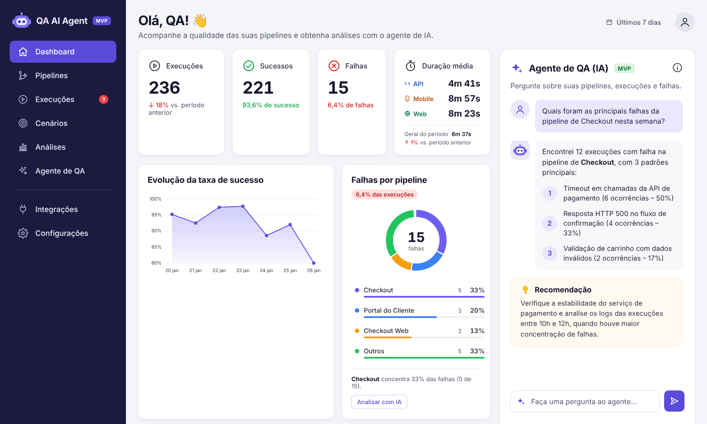
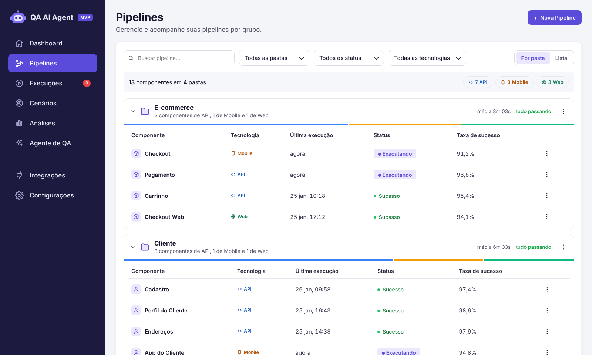
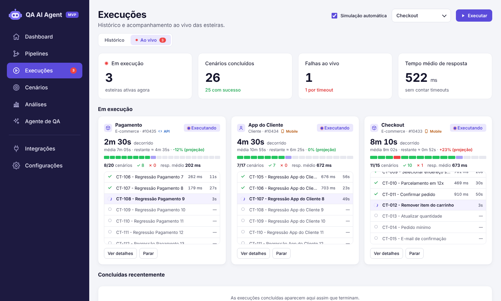
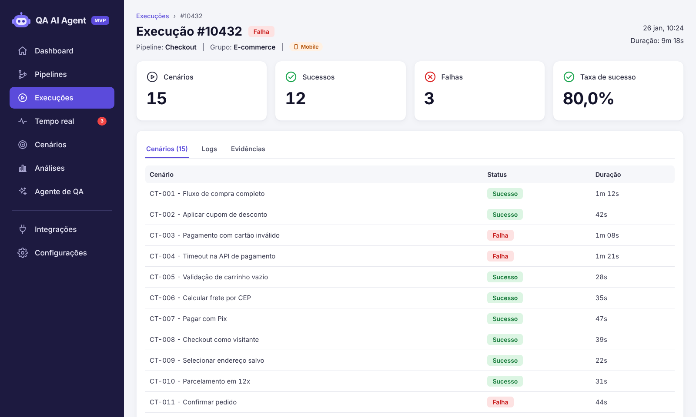
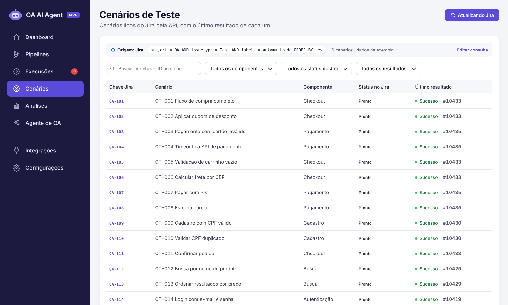
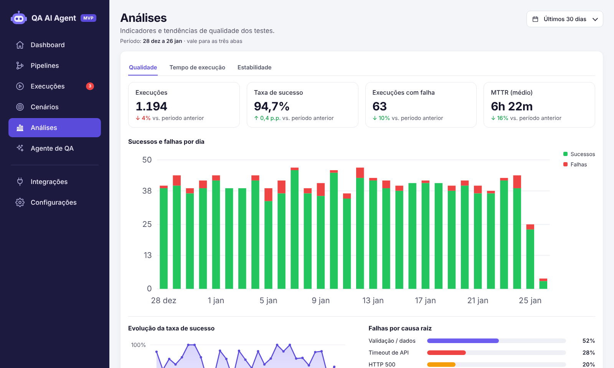
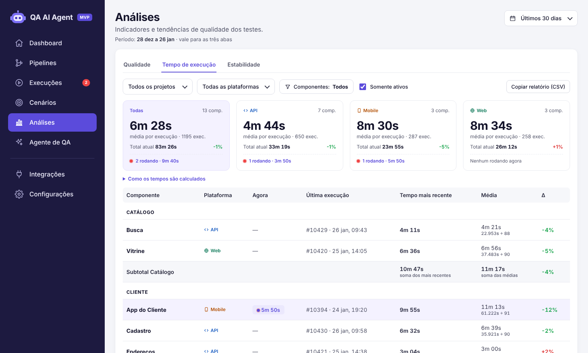
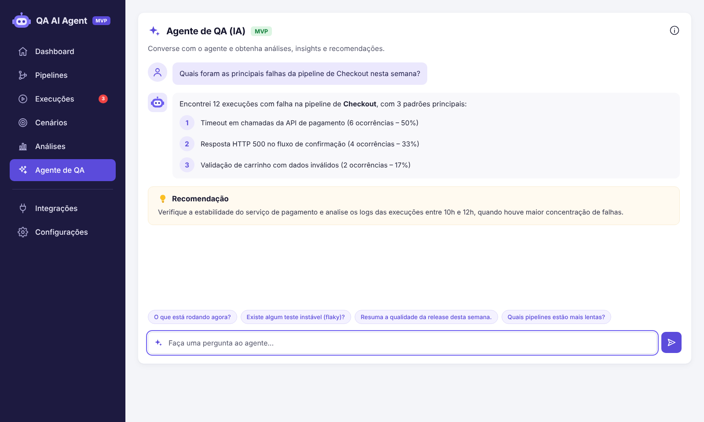
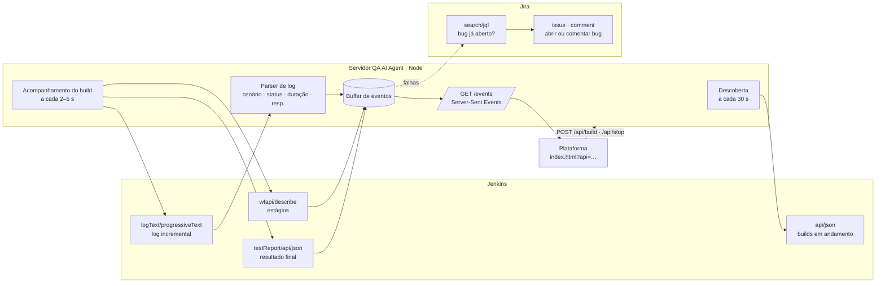
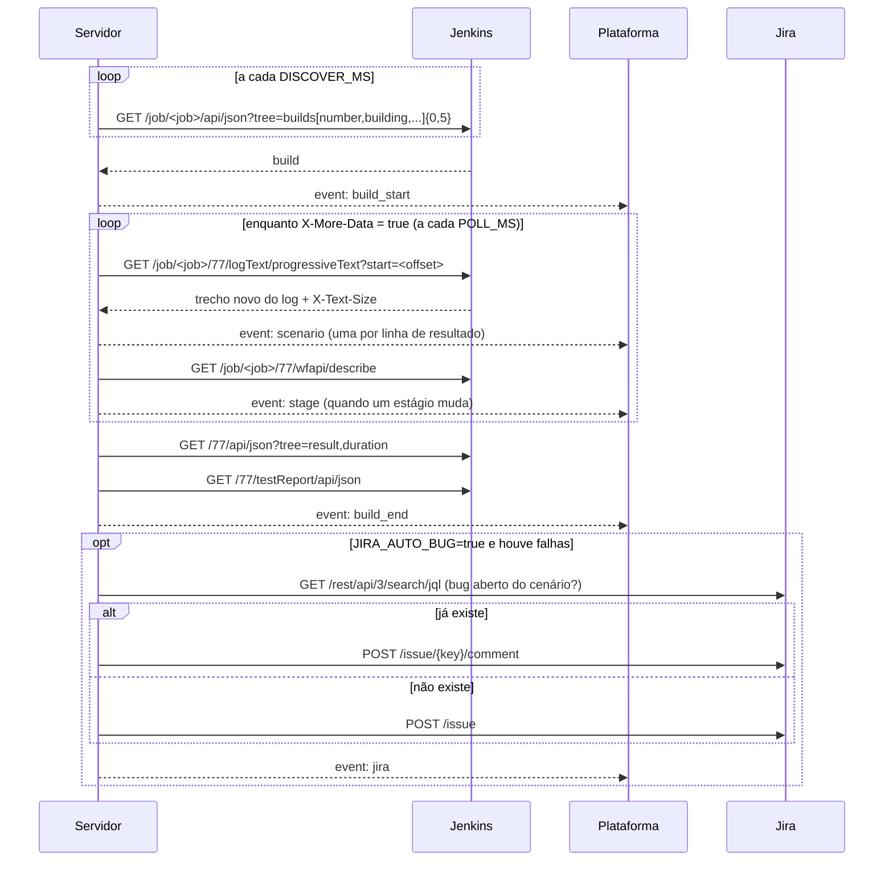

# QA AI Agent


Plataforma para acompanhar a **qualidade das pipelines de teste automatizado**. Ela reúne execuções, cenários, análises de qualidade, acompanhamento **em tempo real** das esteiras e um **agente de IA** que explica falhas e recomenda próximos passos.

O projeto tem duas partes:

| Parte | O que é | Onde |
|---|---|---|
| **Plataforma** | Interface completa (dashboard, pipelines, execuções, tempo real, cenários, análises, agente, integrações e configurações), em um único arquivo HTML sem build | [`index.html`](index.html) |
| **Servidor de tempo real** | Serviço Node.js sem dependências que lê o **Jenkins** e integra com o **Jira** usando apenas as **APIs REST**, e transmite os eventos para a plataforma por **Server-Sent Events (SSE)** | [`server/`](server) |



---

## Sumário

- [Funcionalidades](#funcionalidades)
- [Como executar](#como-executar)
- [Estrutura do projeto](#estrutura-do-projeto)
- [Tempo real: arquitetura](#tempo-real-arquitetura)
- [Servidor de tempo real](#servidor-de-tempo-real)
- [Conexão com o Jenkins (API REST)](#conexão-com-o-jenkins-api-rest)
- [Conexão com o Jira (API REST)](#conexão-com-o-jira-api-rest)
- [Contrato de eventos (SSE)](#contrato-de-eventos-sse)
- [Rotas do servidor](#rotas-do-servidor)
- [Segurança](#segurança)
- [Dados, persistência e limitações do MVP](#dados-persistência-e-limitações-do-mvp)
- [Personalização](#personalização)
- [Solução de problemas](#solução-de-problemas)
- [Roadmap](#roadmap)

---

## Funcionalidades

Cada informação aparece **em um lugar só**: o resumo fica no Dashboard, os componentes em Pipelines, o acompanhamento em Execuções, os cenários do Jira em Cenários e as métricas em Análises.

| Tela | Para que serve |
|---|---|
| **Dashboard** | Resumo do período e painel do agente de IA |
| **Pipelines** | Pastas (projetos) e componentes; único lugar da contagem por pasta |
| **Execuções** | Abas **Histórico** e **Ao vivo** |
| **Cenários** | Cenários lidos do **Jira pela API**, com o último resultado |
| **Análises** | Abas **Qualidade**, **Tempo de execução** e **Estabilidade**, sem sobreposição |
| **Agente de QA** | Chat com análises e recomendações |
| **Integrações / Configurações** | Conexões e preferências |

### 1. Dashboard (visão geral)
- Mostra sempre os **últimos 7 dias**, calculados a partir das execuções: **execuções** (com a variação em relação aos 7 dias anteriores), **sucessos**, **falhas** e **duração média por plataforma**. O filtro de período fica em **Análises**.
- **Duração média por plataforma:** o card mostra em destaque a média de **API**, **Mobile** e **Web**, cada uma com uma barra comparativa e o número de execuções.
  - **Cada plataforma tem a sua própria média**, que não é derivada do total: soma das durações das execuções concluídas daquela plataforma no período ÷ nº de execuções dela.
  - Passar o mouse mostra a conta (por exemplo `5.628s ÷ 20 execuções`).
  - A média geral do período aparece pequena no rodapé do card, só como referência.
- Gráfico de **evolução da taxa de sucesso**.
- **Falhas por pipeline:** rosca com o total no centro e legenda com quantidade, % e barra por pipeline. Passar o mouse destaca o segmento na rosca.
- **Últimas execuções** e painel do **Agente de QA (IA)**.

### 2. Pipelines (por pasta)
- **Visão por pasta** (padrão). Cada pasta (projeto) mostra:
  - em uma frase, a composição, como *“3 componentes de API, 1 de Mobile e 1 de Web”*;
  - a barra de composição, o tempo médio e o estado (*tudo passando* ou *N com falha*).
- Resumo no topo (*“13 componentes em 4 pastas”*), com contadores por tecnologia que também filtram.
- **Visão em lista**, com filtros por texto, pasta, status e tecnologia.
- **Menu ⋮ da pasta:**
  - **Executar todos os componentes**;
  - **Ver tempo de execução**, que abre Análises já filtrada pelo projeto;
  - **Renomear pasta**;
  - **Excluir pasta**. A confirmação lista os componentes e avisa sobre execuções em andamento, que são interrompidas. Ela oferece duas opções: excluir os cenários vinculados (marcada por padrão) e apagar o histórico (desmarcada por padrão, para preservar a auditoria). É preciso **digitar o nome da pasta** para confirmar, e há **Desfazer** por alguns segundos.
- **Menu ⋮ do componente:** executar agora, ativar ou desativar, ver execuções, analisar com IA e excluir. O botão **+ Nova Pipeline** pede nome, pasta, número de cenários e tecnologia.



### 3. Execuções
- Duas abas no topo: **Histórico** e **Ao vivo**. O contador vermelho mostra quantas esteiras estão rodando.
- **Histórico:** lista paginada, com busca por número ou pipeline, filtros por pipeline, status e período, e **Importar JSON** (veja o [formato](#formato-do-importar-json)).
- **Ao vivo** (atualiza a cada segundo):
  - indicadores: esteiras em execução, cenários concluídos, falhas (quantas por timeout) e tempo médio de resposta;
  - **um card por esteira:**
    - tempo decorrido × média, tempo restante e Δ projetado;
    - barra com um segmento por cenário: verde se passou, vermelho se falhou, roxo se está rodando, cinza se está pendente;
    - lista dos cenários com status, **tempo de resposta (ms)** e duração;
    - ações **Ver detalhes** e **Parar**, que no modo conectado para o build no Jenkins;
  - **concluídas recentemente**, com Analisar com IA e Reexecutar;
  - **eventos**: feed com cada cenário, início e fim de esteira, estágios do Jenkins e bugs do Jira.



### 4. Detalhe da execução
- Cabeçalho com pipeline, pasta, tecnologia, data e duração.
- Indicadores de cenários, sucessos, falhas e taxa de sucesso.
- Abas **Cenários**, **Logs** e **Evidências**.
- Botões **Analisar falhas com IA** e **Reexecutar pipeline**.
- Atualiza ao vivo enquanto a execução está rodando.



### 5. Cenários de teste (lidos do Jira)
- Os cenários **não são cadastrados na plataforma**. Eles vêm do **Jira pela API REST**: o servidor chama o endpoint de busca de issues com uma consulta **JQL**, a linguagem de busca da própria API do Jira.
- A faixa **Origem: Jira** mostra a consulta usada, quantos cenários vieram e a hora da última atualização.
  - **Editar consulta** permite trocar a JQL e o **campo que indica o componente** (`components`, `labels` ou um campo personalizado como `customfield_10045`).
  - **Atualizar do Jira** recarrega a lista.
- Colunas:
  - **chave Jira**, com link para a issue;
  - **cenário** (ID `CT-xxx` e nome);
  - **componente**;
  - **status no Jira**;
  - **último resultado**: Sucesso, Falha ou Executando, com link para a execução.
- Filtros por texto (chave, ID ou nome), componente, status no Jira e último resultado.
- Sem servidor conectado, a tela mostra cenários de exemplo no mesmo formato.



### 6. Análises
O **filtro de período** (7, 15, 30 ou 90 dias) fica no topo e vale para as três abas. O intervalo de datas aparece logo abaixo do título. Tudo é **recalculado a partir das execuções do período**, e cada indicador é comparado com o período anterior de mesmo tamanho (por exemplo, 30 dias contra os 30 dias antes deles).

**Qualidade:** o que aconteceu no período.
- Indicadores: execuções, taxa de sucesso, execuções com falha e **MTTR** (tempo médio entre uma falha e a próxima execução com sucesso do mesmo componente).
- Sucessos e falhas **por dia**, ou **por semana** no filtro de 90 dias, e a evolução da taxa de sucesso.
- Falhas por causa raiz, agrupadas pela mensagem de erro, e **mapa de calor de falhas por dia da semana e horário**, com o pico destacado.



**Tempo de execução:** uma única visão para acompanhamento e **auditoria**.
- **Filtros:** projeto (pasta), plataforma, **componentes** (um ou vários, agrupados por projeto) e *somente ativos*.
- **Cards Todas, API, Mobile e Web**, cada um com:
  - a **média própria da plataforma** (Σ durações das execuções dela ÷ nº de execuções dela);
  - o **tempo total atual** (soma da execução mais recente de cada componente) com o Δ em relação à soma das médias;
  - quantos estão **rodando agora** e o tempo decorrido.
- **Tabela por componente**, agrupada por projeto:
  - colunas: execução agora (ao vivo), última execução (número e data), tempo mais recente, média com a conta `Σ ÷ n` e Δ;
  - **subtotal por projeto** e **total geral**, comparando a soma dos mais recentes com a soma das médias.
- **Como os tempos são calculados:** um painel expansível com as fórmulas.
- **Copiar relatório (CSV):** copia a tabela filtrada, com período, filtros e a média de cada plataforma, para colar no Excel ou no Google Planilhas.
- Atualiza ao vivo a cada segundo. Os componentes adicionados depois entram sozinhos.



**Estabilidade:** onde e o que falha.
- **Falhas por componente**, só com quem falhou, e a contagem de quem não falhou.
- **Abaixo da meta de sucesso**: os componentes abaixo da meta definida em Configurações.
- **Testes instáveis (flaky):** cenários que falharam e também passaram no período, com falhas / execuções, taxa de falha e o atalho para a análise da IA.

### 7. Agente de QA (chat)
- Chat em tela cheia, que é o mesmo do painel do dashboard, com sugestões de perguntas.
- Responde sobre:
  - falhas por pipeline;
  - uma execução específica (por exemplo *“Por que a execução #10432 falhou?”*);
  - testes instáveis;
  - pipelines mais lentas;
  - resumo da release;
  - o que está rodando agora.
- Mostra os padrões de falha numerados e uma **recomendação**.

> No MVP o agente funciona por **regras sobre os dados carregados**. Ainda não chama um modelo de IA. Veja o [roadmap](#roadmap).



### 8. Integrações
- **Azure DevOps**, **GitLab CI**, **Jenkins**, **Jira** e **Importação de Arquivo (JSON)**.
- Cada uma tem uma tela de configuração (URL, projeto e token), o status *Conectado* e as opções de sincronizar e desconectar.

> As telas de integração do front-end guardam só o estado da interface. **A conexão real com Jenkins e Jira é feita pelo [servidor](#servidor-de-tempo-real)**, que mantém os tokens fora do navegador.

### 9. Configurações
- **Geral**: nome do workspace, idioma, fuso horário, alertas de falha e resumo semanal.
- **IA e Prompts**: provedor (OpenAI, Anthropic, Azure OpenAI), modelo, **prompt do agente**, temperatura e análise automática de falhas.
- **Dados**: retenção do histórico, meta de taxa de sucesso e restauração dos dados de exemplo.
- **Usuários (MVP)**: lista de usuários e papéis.

---

## Como executar

### Só a plataforma (dados de exemplo + simulação)

Não há build. Abra o arquivo diretamente ou sirva a pasta:

```bash
# opção 1: abrir no navegador
open index.html            # macOS
xdg-open index.html        # Linux

# opção 2: servidor estático local
python3 -m http.server 8080
# acesse http://localhost:8080
```

Sem servidor conectado, a aba **Execuções › Ao vivo** roda uma **simulação 10× acelerada**: três esteiras já em andamento ao abrir e novas execuções iniciadas automaticamente. Ela pode ser desligada em *Simulação automática*.

### Plataforma + servidor de tempo real

```bash
cd server
cp .env.example .env       # preencha Jenkins e Jira
npm start                  # ou: node --env-file=.env server.js
```

Abra a plataforma apontando para o servidor:

```
http://localhost:8080/index.html?api=http://localhost:3000
http://localhost:8080/index.html?api=https://qa-api.suaempresa.com&key=SUA_API_KEY#aovivo
```

Com `?api=`:
- a simulação é desligada;
- a aba muda para **“Ao vivo · Jenkins”**;
- a tela **Cenários** passa a ler os cenários do Jira (botão **Atualizar do Jira**);
- os cards passam a refletir os builds reais;
- **Executar** dispara o build no Jenkins e **Parar** interrompe o build.

### Testar sem Jenkins (modo demonstração)

```bash
cd server
npm run demo               # DEMO=true: gera builds e cenários fictícios via SSE
```

Depois abra `index.html?api=http://localhost:3000#aovivo`.

### Publicar a plataforma no GitHub Pages

*Settings → Pages → Deploy from a branch → `main` / root*. A plataforma fica em `https://<usuario>.github.io/qa-ai-agent/`. Configure `CORS_ORIGIN` no servidor com essa origem.

### Testes do servidor

```bash
cd server
npm test
```

O teste sobe um **Jenkins falso** e verifica:
- a descoberta do build;
- a leitura progressiva do log, inclusive com uma linha cortada entre duas leituras;
- o tempo de resposta;
- os estágios;
- o resultado final.

---

## Estrutura do projeto

```
qa-ai-agent/
├── index.html              # plataforma completa (HTML + CSS + JS, sem dependências)
├── README.md
├── docs/
│   └── img/                # capturas de tela usadas no README
└── server/
    ├── server.js           # servidor de tempo real (Jenkins + Jira + SSE)
    ├── package.json        # scripts start / demo / test (sem dependências)
    ├── .env.example        # todas as variáveis de configuração
    └── test/
        ├── jenkins.test.js # teste de integração com Jenkins falso
        └── jira.test.js    # leitura de cenários no Jira falso (paginação v3)
```

Dentro do `index.html`, o script está dividido em blocos comentados:

| Bloco | Responsabilidade |
|---|---|
| Dados de exemplo | Pipelines (pasta e tecnologia), execuções, cenários e suítes |
| 1. Dashboard … 9. Configurações | Renderização de cada tela |
| Navegação | Rotas por hash (`#dashboard`, `#pipelines`, `#execucoes`, `#aovivo` (Execuções › Ao vivo), `#exec-10432`, `#cenarios`, `#analises`, `#agente`, `#integracoes`, `#config`) |
| Motor de tempo real | Simulação, cards ao vivo, tabela por componente e feed de eventos |
| Eventos reais (SSE) | `extStart`, `extScenario` e `extEnd`, que traduzem os eventos do servidor para a tela |
| Agente de IA | Regras de resposta e conversa |

---

## Tempo real: arquitetura

A conexão com o Jenkins e o Jira é feita **toda por API REST (polling)**. Você não precisa de plugin de webhook, nem de mudança no Jenkinsfile, nem de reporter especial nos testes.



### Fluxo de um build



**Por que SSE e não WebSocket?** O fluxo é de mão única (servidor → tela), e o SSE:
- funciona sobre HTTP comum, inclusive atrás de proxies;
- reconecta sozinho (`retry: 3000`);
- não precisa de biblioteca nenhuma, nem no servidor nem no navegador (`EventSource`).

Os comandos da tela, como executar e parar, vão por `POST` normal.

**Latência esperada:** o intervalo de polling (`POLL_MS`, padrão 3 s) mais o tempo do teste imprimir a linha no console. Para uma tela de acompanhamento, 2–5 s é o equilíbrio entre atraso e carga no Jenkins.

---

## Servidor de tempo real

- **Requisitos:** Node.js **20.6+** (usa `fetch` nativo e `--env-file`). Não há `npm install`.
- **Configuração:** todas as variáveis estão em [`server/.env.example`](server/.env.example).

| Variável | Padrão | Descrição |
|---|---|---|
| `PORT` | `3000` | Porta HTTP |
| `CORS_ORIGIN` | `*` | Origem permitida da plataforma (por exemplo `https://usuario.github.io`) |
| `API_KEY` | vazio | Se definida, é exigida em `/events?key=` e no header `x-api-key` das rotas POST |
| `DEMO` | `false` | `true` gera execuções fictícias, sem Jenkins |
| `JENKINS_URL` | — | Endereço do Jenkins |
| `JENKINS_USER` / `JENKINS_TOKEN` | — | Usuário e **API token** (Basic Auth) |
| `JENKINS_JOBS` | — | Jobs acompanhados, separados por vírgula. Jobs em pastas: `Pasta/Sub/Job` |
| `POLL_MS` | `3000` | Intervalo de leitura do log de um build em andamento |
| `DISCOVER_MS` | `30000` | Intervalo para descobrir builds novos |
| `LOG_REGEX` | embutida | Regex própria para as linhas de resultado (grupos `status`, `name`, `dur`, `unit`) |
| `RESP_REGEX` | `\[resp\]\s+(?<name>.+?)\s+(?<ms>\d+)\s*ms` | Regex do tempo de resposta (grupos `name`, `ms`) |
| `JIRA_URL` | — | Por exemplo `https://suaempresa.atlassian.net` |
| `JIRA_EMAIL` / `JIRA_TOKEN` | — | E-mail e API token (Cloud) ou usuário e token pessoal (Server/DC) |
| `JIRA_PROJECT` | — | Chave do projeto (por exemplo `QA`) |
| `JIRA_API_VERSION` | `3` | `3` = Cloud · `2` = Server/Data Center |
| `JIRA_AUTO_BUG` | `false` | Abre ou comenta um bug para cada cenário que falhar |
| `JIRA_ISSUE_TYPE` | `Bug` | Tipo de issue criado |
| `JIRA_LABELS` | `qa-ai-agent` | Labels aplicadas, separadas por vírgula |
| `JIRA_SCENARIOS_JQL` | `project = QA AND issuetype = Test ORDER BY key` | Consulta (JQL) usada na API do Jira para buscar os cenários |
| `JIRA_PIPELINE_FIELD` | `components` | Campo do Jira que indica o componente do cenário (`components`, `labels` ou `customfield_xxxxx`) |

---

## Conexão com o Jenkins (API REST)

### Autenticação
1. No Jenkins: **seu usuário → Security → API Token → Add new Token**.
2. Use `JENKINS_USER` e `JENKINS_TOKEN`. O servidor envia `Authorization: Basic base64(usuario:token)`.

Com API token, o Jenkins **não exige crumb (CSRF)** para `POST` (build e stop). Dê ao usuário, no mínimo, as permissões **Overall/Read**, **Job/Read** e, se for usar Executar e Parar, **Job/Build** e **Job/Cancel**.

### Endpoints usados

| Para quê | Endpoint |
|---|---|
| Descobrir builds em andamento | `GET /job/<job>/api/json?tree=builds[number,building,timestamp,estimatedDuration]{0,5}` |
| **Log incremental (tempo real por cenário)** | `GET /job/<job>/<n>/logText/progressiveText?start=<offset>` |
| Estágios da pipeline | `GET /job/<job>/<n>/wfapi/describe` (plugin *Pipeline: Stage View*; se não existir, é ignorado) |
| Resultado e duração | `GET /job/<job>/<n>/api/json?tree=result,duration` |
| Totais do relatório de testes | `GET /job/<job>/<n>/testReport/api/json?tree=passCount,failCount,skipCount` (exige `junit` publicado) |
| Disparar build | `POST /job/<job>/build` ou `/buildWithParameters` |
| Parar build | `POST /job/<job>/<n>/stop` |

Jobs dentro de pastas viram `/job/Pasta/job/Sub/job/Job`. O servidor monta esse caminho sozinho a partir de `Pasta/Sub/Job`.

### Como o tempo real por cenário funciona
O `progressiveText` devolve **só o trecho novo do log** a partir de `start`. Ele também traz dois cabeçalhos:
- `X-Text-Size`: onde continuar na próxima leitura;
- `X-More-Data: true`: enquanto o build não terminou.

O servidor:
- guarda o resto de linha que veio cortado entre uma leitura e outra;
- remove as cores ANSI;
- reconhece as linhas de resultado.

Formatos reconhecidos **por padrão**:

```text
# Playwright (reporter "list")
  ✓  1 [chromium] › checkout.spec.ts:12:5 › CT-001 Fluxo de compra completo (1.2s)
  ✘  3 [chromium] › checkout.spec.ts:30:5 › CT-004 Timeout na API de pagamento (30.0s)
# Cypress / Mocha (reporter "spec")
  ✓ CT-002 Aplicar cupom de desconto (842ms)
# Jest
  ✕ CT-010 Validar CPF duplicado (12 ms)
```

Para outro formato (Robot Framework, Karate, pytest, Cucumber…), defina `LOG_REGEX` com grupos nomeados:

```bash
# pytest -v:  tests/test_checkout.py::test_ct_001_fluxo_compra PASSED  [ 10%]
LOG_REGEX=^(?<name>\S+::\S+)\s+(?<status>PASSED|FAILED)
# Robot Framework:  CT-001 Fluxo de compra completo                | PASS |
LOG_REGEX=^(?<name>CT-\d+.+?)\s+\|\s+(?<status>PASS|FAIL)\s+\|
```

Os status de sucesso aceitos são `✓ ✔ √ ok OK pass passed PASS PASSED Passed SUCCESS`, e qualquer outro conta como falha. Se a sua ferramenta usa outra palavra, acrescente-a ao conjunto `PASS` em `server.js`. A duração é opcional.

### Tempo de resposta (ms) de cada cenário
O tempo de resposta não aparece no log por padrão. Basta o teste imprimir uma linha antes de terminar:

```js
// Playwright
const inicio = Date.now();
const resp = await request.post('/api/payments/authorize', { data });
console.log(`[resp] CT-004 Timeout na API de pagamento ${Date.now() - inicio}ms`);
```

O servidor associa a linha `[resp]` ao cenário pelo nome ou pelo ID `CT-xxx`, e envia o valor no evento `scenario`. O formato pode ser trocado em `RESP_REGEX`.

### Boas práticas
- Comece cada nome de cenário com o ID (`CT-001 …`). Isso liga o log, a plataforma e o Jira.
- Publique o JUnit (`junit 'results/*.xml'`) para o total final vir do `testReport`.
- Mantenha `POLL_MS` entre 2000 e 5000 e `DISCOVER_MS` entre 15000 e 60000.

---

## Conexão com o Jira (API REST)

### Autenticação

| Jira | Credenciais | `JIRA_API_VERSION` |
|---|---|---|
| **Cloud** | E-mail + API token (gere em `id.atlassian.com → Security → API tokens`) | `3` |
| **Server / Data Center** | Usuário + Personal Access Token | `2` |

### Cenários de teste (leitura pela API)
A tela **Cenários** chama `GET /api/jira/scenarios`. O servidor então consulta a API de busca do Jira com a JQL configurada, paginando até 1000 issues:
- **Cloud (v3):** `GET /rest/api/3/search/jql?jql=…&fields=summary,status,components,labels,updated&nextPageToken=…`
- **Server/DC (v2):** `GET /rest/api/2/search?jql=…&startAt=…`

O resultado vem assim:

```json
{ "scenarios": [ { "key": "QA-101", "name": "CT-001 Fluxo de compra completo", "status": "Pronto",
                   "pipeline": "Checkout", "url": "https://suaempresa.atlassian.net/browse/QA-101" } ] }
```

- **Consulta padrão:** `JIRA_SCENARIOS_JQL`. A plataforma pode mandar outra com *Editar consulta*.
- **Componente/pipeline:** vem do campo `JIRA_PIPELINE_FIELD`: `components` (padrão), `labels` ou `customfield_xxxxx`.
- **ID do cenário:** se o título da issue começa com `CT-xxx`, esse ID liga o cenário às linhas do log do Jenkins e ao último resultado.

### O que o servidor faz com as falhas
Com `JIRA_AUTO_BUG=true`, ao fim de cada build, para cada cenário que falhou:

1. **Procura um bug aberto** do mesmo cenário:
   - Cloud: `GET /rest/api/3/search/jql?jql=project="QA" AND summary ~ "\"CT-004\"" AND statusCategory != Done`
   - Server: `GET /rest/api/2/search?jql=…`
2. **Se existe:** adiciona um comentário com `POST /rest/api/{v}/issue/{chave}/comment`, sem criar duplicado.
3. **Se não existe:** cria o bug com `POST /rest/api/{v}/issue`:
   - título `[QA] <job> – <cenário>`;
   - descrição com o cenário, o build e o link do build;
   - labels de `JIRA_LABELS`.
4. Envia o evento `jira` para a plataforma, que aparece no feed **Eventos**.

No Jira Cloud (v3), a descrição e o comentário vão em **Atlassian Document Format (ADF)**. O servidor converte o texto sozinho.

Para abrir um bug manualmente, por exemplo a partir de um botão:

```bash
curl -X POST http://localhost:3000/api/jira/bug \
  -H 'Content-Type: application/json' -H 'x-api-key: SUA_API_KEY' \
  -d '{"job":"E-commerce/Checkout","build":77,"scenario":"CT-004 Timeout na API de pagamento"}'
```

Permissões necessárias no projeto: **Browse Projects**, **Create Issues** e **Add Comments**.

---

## Contrato de eventos (SSE)

`GET /events` mantém a conexão aberta e envia eventos no formato:

```
event: <tipo>
data: <json>
```

Ao conectar, o cliente recebe os **últimos 300 eventos**, para montar o estado atual. Qualquer outra fonte (GitLab, Azure DevOps, um reporter próprio) pode alimentar a plataforma, desde que publique estes eventos.

| Evento | Quando | Campos |
|---|---|---|
| `build_start` | Build descoberto em andamento | `job`, `build`, `timestamp`, `estimatedDuration`, `folder?`, `url`, `total?`, `scenarios?` |
| `scenario` | Uma linha de resultado no log | `job`, `build`, `name`, `status` (`pass`/`fail`/`run`), `duration` (s), `resp` (ms ou `null`), `elapsed` (s) |
| `stage` | Estágio do Jenkins mudou de status | `job`, `build`, `stage`, `status`, `duration` (ms) |
| `build_end` | Build terminou | `job`, `build`, `status` (`Sucesso`/`Falha`/`Cancelada`), `duration` (ms), `passed`, `failed`, `total`, `result` |
| `jira` | Bug criado ou comentado | `job`, `build`, `scenario`, `key`, `action` (`create`/`comment`), `url` |

Exemplo:

```json
{"job":"E-commerce/Checkout","build":77,"name":"CT-004 Timeout na API de pagamento","status":"fail","duration":30,"resp":30000,"elapsed":64}
```

Consumo no navegador, como a plataforma faz:

```js
const es = new EventSource('http://localhost:3000/events?key=SUA_API_KEY');
es.addEventListener('scenario', e => console.log(JSON.parse(e.data)));
```

---

## Rotas do servidor

| Método | Rota | Autenticação | Descrição |
|---|---|---|---|
| `GET` | `/api/health` | livre | Estado do servidor: modo demo, Jenkins/Jira configurados, clientes conectados, builds ativos |
| `GET` | `/events` | `?key=` | Fluxo SSE de eventos |
| `GET` | `/api/state` | `x-api-key` ou `?key=` | Builds em acompanhamento, com cenários e estágios |
| `POST` | `/api/build` | `x-api-key` | `{ "job": "E-commerce/Checkout", "params": { "AMBIENTE": "hml" } }` dispara o build |
| `POST` | `/api/stop` | `x-api-key` | `{ "job": "...", "build": 77 }` para o build |
| `GET` | `/api/jira/scenarios` | `x-api-key` | `?jql=...&field=components` busca os cenários de teste no Jira |
| `POST` | `/api/jira/bug` | `x-api-key` | `{ "job", "build", "scenario", "details?" }` abre ou comenta o bug |

---

## Segurança

- **Tokens do Jenkins e do Jira ficam só no servidor**, em `.env`, que está no `.gitignore`. Nunca coloque tokens no `index.html`.
- Defina `API_KEY` e `CORS_ORIGIN` em produção.
- Publique o servidor atrás de **HTTPS**, por exemplo com Nginx, Caddy ou o load balancer da empresa.
- Use um usuário técnico no Jenkins e no Jira, com as **permissões mínimas** listadas acima.
- O `?key=` na URL aparece no histórico do navegador. Para ambientes sensíveis, prefira colocar o servidor e a plataforma atrás do SSO da empresa e deixar `API_KEY` como segunda camada.

---

## Dados, persistência e limitações do MVP

- Sem servidor, a plataforma usa **dados de exemplo**: 13 componentes em 4 pastas, cerca de 7.600 execuções distribuídas em 6 meses (para o filtro de período e a comparação com o período anterior funcionarem) e cenários `CT-001…`.
- Pipelines, cenários, integrações e configurações criados na interface ficam no **`localStorage` do navegador**. Eles não são compartilhados entre pessoas ou máquinas. *Configurações → Dados → Restaurar dados de exemplo* limpa tudo.
- No modo conectado, as execuções reais aparecem em **Execuções** (Histórico e Ao vivo), no **Detalhe**, nas **Últimas execuções** e em **Análises › Tempo de execução**, e os cenários vêm do **Jira**. O histórico de longo prazo e os indicadores de **Análises** ainda vêm dos dados de exemplo, até que exista um banco (veja o roadmap).
- O **agente de IA** responde por regras. As **Configurações → IA e Prompts** já guardam provedor, modelo, prompt e temperatura para a integração real.
- As telas de **Integrações** do front-end são visuais. A conexão de fato é feita pelo servidor.

### Formato do Importar JSON

```json
[
  { "pipeline": "Checkout", "grupo": "E-commerce", "tecnologia": "Mobile",
    "total": 15, "passed": 12, "duration": 558, "inicio": "2026-01-26T10:24:00" }
]
```

Campos aceitos:
- `pipeline` (ou `p`);
- `total` (ou `cenarios`, `t`);
- `passed` (ou `sucessos`, `ok`);
- `duration` (ou `duracao`), em segundos;
- `inicio` (ou `start`);
- `grupo` (ou `group`);
- `tecnologia` (ou `tech`).

Também é aceito um objeto `{ "executions": [...] }`.

---

## Personalização

- **Cores e tipografia:** tokens CSS no `:root` do `index.html`, por exemplo `--sidebar`, `--primary`, `--green`, `--red` e `--font` (Inter).
- **Tecnologias:** a constante `TECHS = ['API','Mobile','Web']` e os mapas `techCls` e `TECH_IC`.
- **Pastas e componentes:** o array `PIPES`, com `name`, `group` (pasta), `tech`, `rate`, `dur` e `scen`.
- **Velocidade da simulação:** `SPEED` (padrão 10×).
- **Regras do agente:** a função `answer()`.

---

## Solução de problemas

| Sintoma | Causa provável | O que fazer |
|---|---|---|
| “Sem conexão com o servidor de tempo real” | Servidor parado, URL errada ou CORS | Confira `GET /api/health` e o valor de `CORS_ORIGIN` |
| `401` em `/events` | `API_KEY` definida e `?key=` ausente ou errado | Adicione `&key=` na URL da plataforma |
| Build aparece, mas nenhum cenário | O formato do log não bate com a regex | Veja o console do build e ajuste `LOG_REGEX` |
| Cenários aparecem só no fim | O framework só imprime ao final (buffer) | Use um reporter que imprime por teste, como `--reporter=list` no Playwright ou `spec` no Cypress |
| Tempo de resposta sempre vazio | Não há linhas `[resp]` no log | Imprima `[resp] <cenário> <ms>ms` nos testes |
| `Jenkins 403` | Permissão ou token | Gere um novo API token e confira Job/Read e Job/Build |
| `Jenkins 404` em `testReport` | JUnit não publicado | Adicione `junit '**/results/*.xml'` ou ignore (o total vem do log) |
| `Jira 400` ao criar issue | Campo obrigatório no projeto | Ajuste `fields` em `reportBug()` (componentes, prioridade…) |
| `Jira 410` em `/search` | Endpoint antigo no Cloud | Use `JIRA_API_VERSION=3` (usa `/search/jql`) |

---

## Roadmap

- [ ] Banco de dados (PostgreSQL) para o histórico real alimentar o Dashboard e as Análises.
- [ ] Agente de IA ligado a um modelo (OpenAI, Anthropic ou Azure), usando o prompt das Configurações.
- [ ] Leitores para GitLab CI e Azure DevOps, publicando o mesmo contrato de eventos.
- [ ] Subpastas (por exemplo Cliente › Cadastro › API), com contagens somadas por nível.
- [ ] Botão “Abrir bug no Jira” no detalhe da execução, usando `/api/jira/bug`.
- [ ] Autenticação de usuários (SSO) e papéis.
- [ ] Alertas por e-mail, Slack ou Teams quando uma esteira falhar.

---

Feito por [David Nascimento](https://github.com/David-Nascimento).
