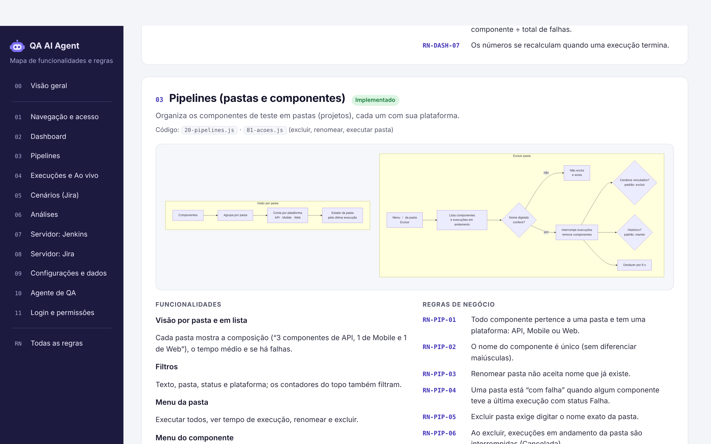
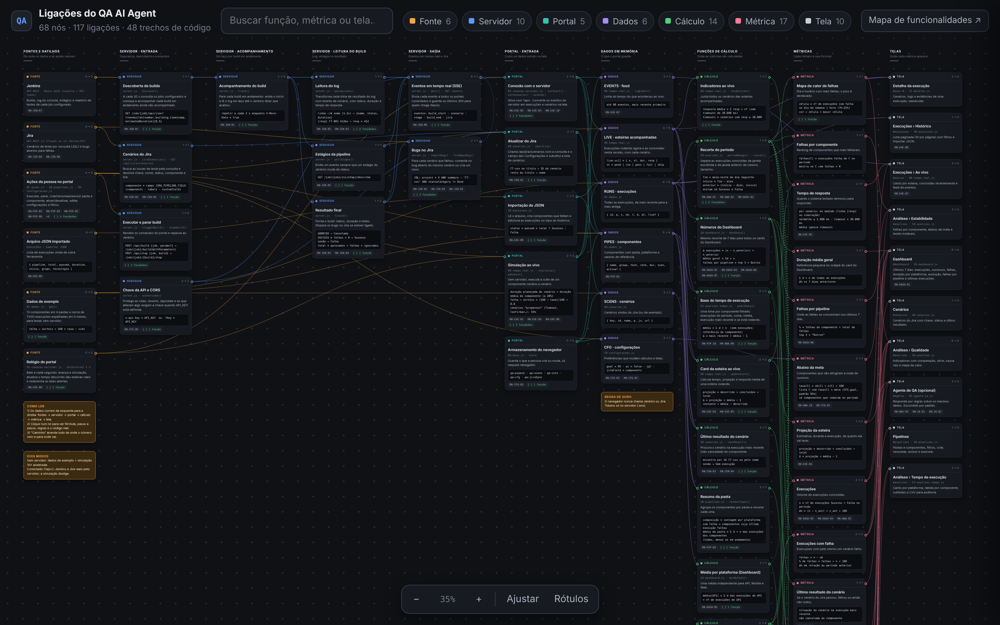
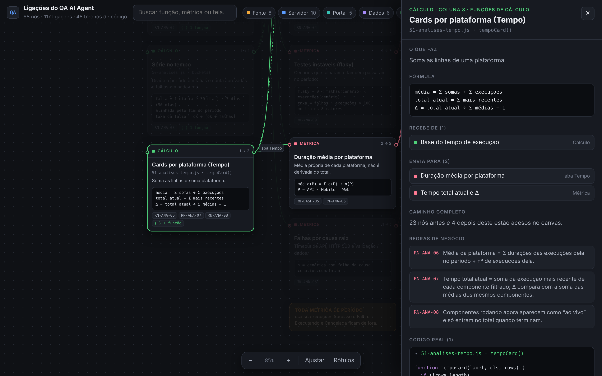

# Mapa de funcionalidades e Canvas de ligações

Dois documentos explicam **como a plataforma funciona por dentro**. Ambos são HTML puro: abra direto no navegador ou pelo GitHub Pages.

| Documento | Para que serve | Arquivo |
|---|---|---|
| **Mapa de funcionalidades** | Visão por **categoria**: o que cada parte faz, o diagrama da lógica e as **regras de negócio numeradas** (RN-…). Tem um catálogo único com todas as regras e filtro. | [`docs/mapa/mapa-funcionalidades.html`](mapa/mapa-funcionalidades.html) |
| **Canvas de ligações** | Visão de **fluxo**: como os dados saem do Jenkins e do Jira, passam pelo servidor, viram dados no portal, são calculados e chegam a cada métrica e tela. Cada nó mostra a **fórmula**, as **regras** e o **código real** da função. | [`docs/mapa/canvas-ligacoes.html`](mapa/canvas-ligacoes.html) |

Os dois se completam: o Mapa responde **"qual é a regra?"** e o Canvas responde **"de onde vem esse número e qual função o calcula?"**. As regras usam a mesma numeração nos dois, e o Canvas tem um link para o Mapa.

## Mapa de funcionalidades



- **12 seções:** visão geral, navegação e acesso, Dashboard, Pipelines, Execuções e Ao vivo, Cenários (Jira), Análises, Servidor: Jenkins, Servidor: Jira, Configurações e dados, Agente de QA e Login e permissões.
- Cada seção tem um **status** (Implementado, Opcional ou Proposta), os arquivos de código, um **diagrama Mermaid** da lógica, as funcionalidades e as **regras de negócio**.
- **Todas as regras:** tabela no fim com busca e filtro por categoria. Ela é montada a partir das regras escritas em cada seção, que são a única fonte.
- Os diagramas usam o Mermaid, carregado do CDN jsDelivr. Sem internet, a página abre normalmente, mas os diagramas aparecem como texto.

## Canvas de ligações



Os dados correm **da esquerda para a direita**, em 10 colunas:

1. **Fontes e gatilhos:** Jenkins, Jira, ações da pessoa, JSON importado, dados de exemplo e o relógio do portal.
2. **Servidor · entrada:** chave da API e CORS, descoberta de builds, executar e parar, cenários do Jira.
3. **Servidor · acompanhamento:** o laço `track()` de cada build.
4. **Servidor · leitura do build:** log (`parseLines`), estágios (`pollStages`) e resultado (`finish`).
5. **Servidor · saída:** eventos SSE (`emit`) e bugs no Jira (`reportBug`).
6. **Portal · entrada:** conexão SSE, simulação, importação, atualizar do Jira e armazenamento do navegador.
7. **Dados em memória:** `RUNS`, `LIVE`, `PIPES`, `SCENS`, `CFG` e `EVENTS`.
8. **Funções de cálculo:** `periodRange`, `metrics`, `mttr`, `scenarioStats`, `failCause`, `buckets`, `dashData`, `durByTech`, `auditData`, `tempoCard`, `updateCard` e outras.
9. **Métricas:** cada número com a sua fórmula (taxa de sucesso, MTTR, média por plataforma, tempo total atual, projeção, flaky…).
10. **Telas:** onde cada métrica aparece.

São **68 nós, 117 ligações e 48 trechos de código**.



### Como usar

- **Mover:** arraste o fundo. **Zoom:** roda do mouse, gesto de pinça ou os botões − / +. **Ajustar** mostra tudo de uma vez.
- **Clique num nó** para abrir o painel com: o que faz, fórmula, passo a passo, de onde recebe e para onde envia (clicáveis), regras de negócio e o código real.
- Ao selecionar um nó, **acende o caminho completo**: tudo o que leva até ele e tudo o que depende dele. As outras partes ficam apagadas.
- **Rótulos** mostra o nome de cada ligação (por exemplo `build_end`, `scenario`, `7 dias`).
- A **busca** encontra função, métrica, tela, arquivo ou código de regra. A **legenda** destaca um tipo de nó.
- O endereço guarda o nó aberto (`canvas-ligacoes.html#m-avgtech`), para mandar um link direto.
- **Esc** fecha o painel.

### Mantendo o Canvas em dia

O Canvas é **gerado a partir do código**. As funções mostradas são lidas de `assets/js/*.js` e `server/server.js`, e os textos das regras vêm do Mapa. Depois de mudar uma função citada, gere de novo na raiz do projeto:

```bash
python3 docs/mapa/gerador/gen.py . docs/mapa/mapa-funcionalidades.html docs/mapa/canvas-ligacoes.html docs/mapa/gerador/template.html --completo
```

| Arquivo | Função |
|---|---|
| `docs/mapa/gerador/gen.py` | Define os nós, as ligações e as fórmulas e extrai o código das funções. |
| `docs/mapa/gerador/template.html` | Visual e comportamento do canvas (zoom, painel, busca). |
| `docs/mapa/gerador/completo.py` | Transforma a página num HTML completo e adiciona o Mermaid quando houver diagramas. |

O gerador **para com erro** quando:

- uma função citada não existe mais (por exemplo, se foi renomeada);
- uma ligação aponta para um nó que não existe;
- uma ligação volta para uma coluna anterior;
- uma regra citada não está no Mapa.

Assim o Canvas não fica desatualizado sem ninguém perceber. Para uma função nova, adicione um `node(...)` em `gen.py` e as ligações com `e(origem, destino, 'rótulo')`.

> Ao criar ou mudar uma **regra de negócio**, atualize primeiro o Mapa (`<li><span class="id">RN-…</span><span>texto</span></li>`) e depois gere o Canvas de novo.
