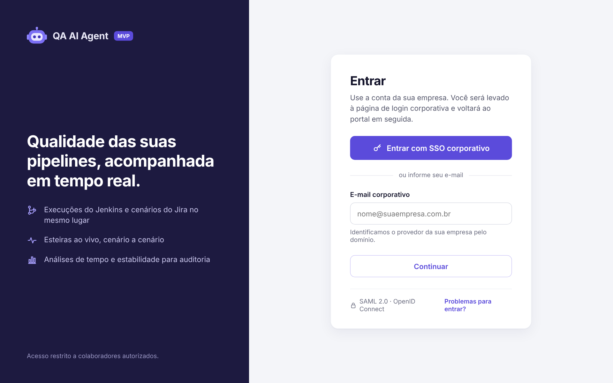
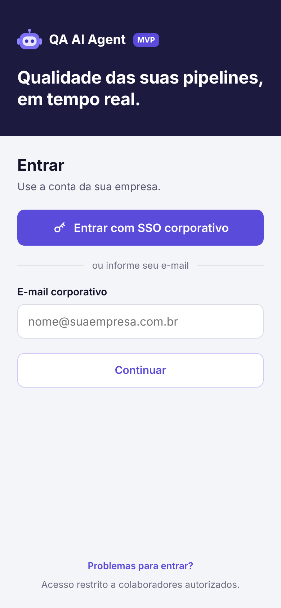
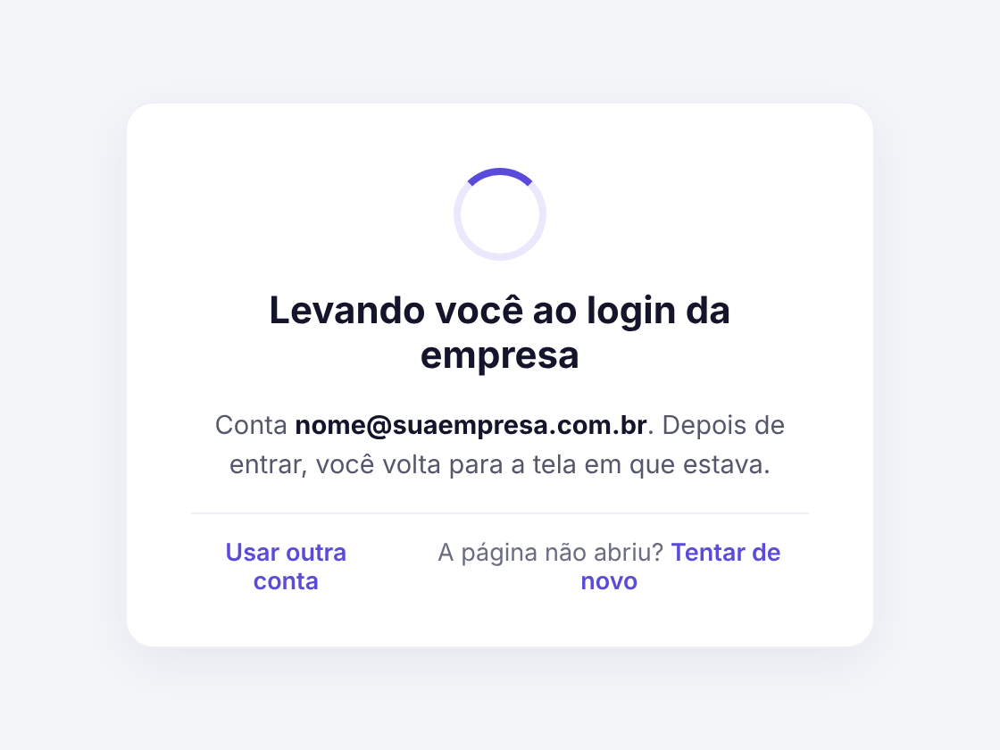
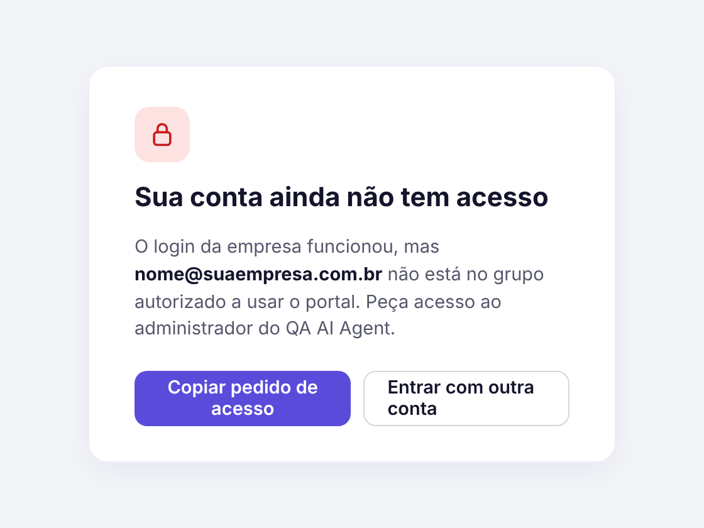
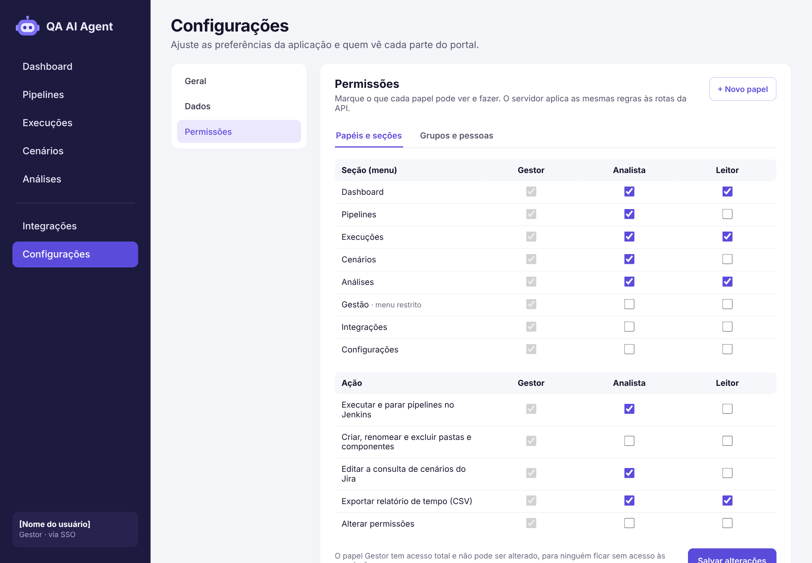
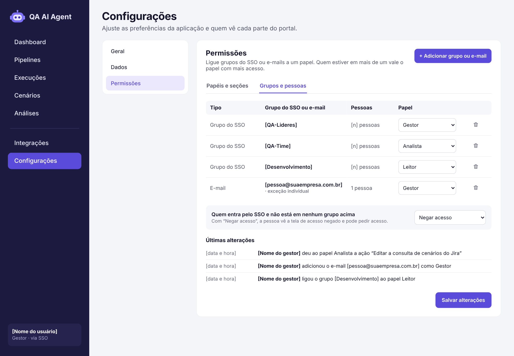
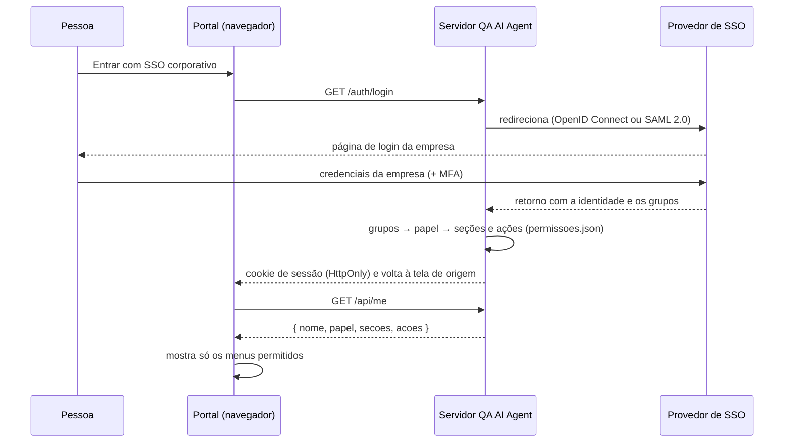

# Login com SSO e permissões (proposta)

> **Status: esboço aprovado para discussão, ainda não implementado.**
> As imagens e os protótipos abaixo mostram como as telas devem ficar. O código entra depois que forem definidos o provedor de SSO e a forma de agrupar as pessoas (veja [Decisões em aberto](#decisões-em-aberto)).

Os protótipos navegáveis ficam em [`docs/prototipos/sso/`](prototipos/sso). São HTML estático: abra no navegador para ver cada tela no tamanho real.

## Telas

### 1. Login — desktop
Painel escuro com a marca à esquerda e o cartão de entrada à direita. O botão principal leva ao **SSO corporativo**. Como alternativa, a pessoa informa o **e-mail corporativo** e o portal descobre o provedor pelo domínio.



### 2. Login — celular
O mesmo conteúdo em uma coluna.



### 3. Redirecionando
Aparece enquanto a pessoa é levada à página de login da empresa. Oferece **Usar outra conta** e **Tentar de novo**.



### 4. Acesso negado
A pessoa entrou com a conta da empresa, mas não está em nenhum grupo autorizado. Ela pode copiar o pedido de acesso para o administrador ou entrar com outra conta.



### 5. Permissões — papéis e seções
Em **Configurações › Permissões**. Uma tabela de papéis (**Gestor**, **Analista**, **Leitor**) × **seções do menu**, inclusive o menu restrito *Gestão*, e uma segunda tabela de papéis × **ações** (executar e parar pipelines, mexer em pastas, editar a consulta do Jira, exportar CSV, alterar permissões). O Gestor tem acesso total e não pode ser alterado, para ninguém perder o acesso às permissões.



### 6. Permissões — grupos e pessoas
Liga **grupos do SSO** ou **e-mails individuais** (exceções) a um papel. Quem estiver em mais de um vale o papel com mais acesso. Também define o que acontece com quem entra pelo SSO sem estar em nenhum grupo (**Negar acesso** ou **Leitor**) e mostra as **últimas alterações**, para auditoria.



## Como vai funcionar



- **O login acontece no servidor.** O segredo do provedor fica no `server/.env`, e o navegador recebe só um cookie de sessão.
- **A tela esconde** os menus e botões que a pessoa não pode usar, com o mesmo mecanismo do interruptor de IA.
- **O servidor bloqueia** as rotas `/api/*` de seções e ações não permitidas. É isso que garante a segurança: mesmo forçando a tela, os dados e as ações não saem do servidor.
- **A primeira versão é por arquivo.** As permissões ficam em `server/permissoes.json`, versionado no Git. A tela de Permissões vem depois, gravando no mesmo formato e registrando cada alteração.

### Formato previsto de `server/permissoes.json`

```json
{
  "papeis": {
    "gestor":   { "secoes": ["*"], "acoes": ["*"] },
    "analista": { "secoes": ["dashboard", "pipelines", "execucoes", "cenarios", "analises"],
                  "acoes": ["executar", "parar", "editar-consulta-jira", "exportar-csv"] },
    "leitor":   { "secoes": ["dashboard", "execucoes", "analises"], "acoes": ["exportar-csv"] }
  },
  "grupos": { "QA-Lideres": "gestor", "QA-Time": "analista", "Desenvolvimento": "leitor" },
  "emails": { "pessoa@suaempresa.com.br": "gestor" },
  "semGrupo": null
}
```

`"semGrupo": null` nega o acesso a quem não está em nenhum grupo. Com `"leitor"`, essas pessoas entram como Leitor.

## Decisões em aberto

- [ ] **Provedor de SSO:** Microsoft Entra ID, Google Workspace, Okta, Keycloak ou outro, e se o protocolo é OpenID Connect ou SAML 2.0.
- [ ] **Grupos:** a empresa já tem grupos no provedor, ou a primeira versão será só por e-mail?
- [ ] **Papéis iniciais:** confirmar Gestor, Analista e Leitor e o que cada um vê.
- [ ] **Quem não está em nenhum grupo:** negar acesso (padrão do esboço) ou entrar como Leitor.
